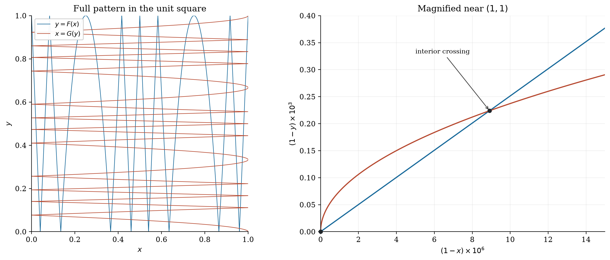

# Compute the invariant, not every unknown

The shortest algebra solution often never finds the individual roots, angles, or sequence terms mentioned in the statement. It computes a symmetric sum, a remainder, a ratio, or a transformed state that the problem actually asks for. The central habit is to preserve information while discarding unnecessary coordinates.

This book organizes that habit into precise tools. A substitution earns its place by simplifying the domain or lowering the degree. A factorization earns its place by exposing branches that can be checked. A recurrence earns its place by producing the requested quantity without reconstructing all the underlying objects.

The companion historical collection contains the full worked instances and source-review notes. These general results are classical unless described as an archive-derived formulation; such a label records how the material was distilled here, not a claim of mathematical priority.

## Before calculating

Write the domain, the target, and the symmetries. Then ask:

1. Does exchanging the unknowns preserve the problem? Use symmetric quantities.
2. Does changing $x$ to $1/x$, $-x$, or $c-x$ preserve it? Use a reciprocal, square, or centered variable.
3. Are only values at roots needed? Work modulo their polynomial.
4. Is an iteration disguised by a change of coordinates? Find a conjugacy.
5. Can a large sum be paired, telescoped, or reconstructed from differences?

Every transformation must carry its exceptional cases. “Divide by $x-y$” is not a reversible step until the case $x=y$ has been resolved.

# 1. Equations and their domains

**Definition.** Two conditions are equivalent on a domain $D$ if they have the same solutions in $D$. A necessary condition may have additional solutions; a sufficient condition may omit solutions.

Squaring $u=v$ gives a necessary condition $u^2=v^2$. It is equivalent when the signs of $u$ and $v$ are known to agree. Clearing a denominator is equivalent only where that denominator is nonzero. Applying a logarithm requires positive arguments; reversing an inequality through a decreasing logarithm changes its direction.

**Lemma 1.1.** If $a,b\ge0$, then $\sqrt a=b$ is equivalent to $a=b^2$ together with $b\ge0$.

The apparently redundant sign condition is the entire reason an extraneous root can arise in a radical equation.

**Lemma 1.2 (one-parameter feasibility).** Real numbers $x,y$ with prescribed sum $s$ and product $p$ exist exactly when $s^2-4p\ge0$. Both are positive exactly when, in addition, $s>0$ and $p>0$.

**Proof.** They are the roots of $t^2-st+p$. A nonnegative discriminant gives real roots. A positive product gives equal nonzero signs, and the sign of the sum then distinguishes positive from negative roots. $\square$

This lemma turns a two-variable optimization into a one-variable domain: for fixed $s>0$ and positive $x,y$, the product lies in $0<p\le s^2/4$. The upper endpoint is attained at $x=y$; the lower endpoint is only an infimum.

## 1.1 An algebraic answer needs an existence check

If a problem specifies positive numbers and an elimination produces $p=-1$, that algebraic branch is invalid even if the requested symmetric expression happens to be an integer. The AIME answer range is not a substitute for the original conditions. Retain the inequalities that describe the transformed variables and check them before choosing a root.

# 2. Symmetric coordinates

For two variables use $s=x+y$ and $p=xy$. Then

$$x^2+y^2=s^2-2p,\qquad x^3+y^3=s^3-3ps,\qquad (x-y)^2=s^2-4p.$$

**Theorem 2.1.** Every symmetric polynomial in two variables can be written as a polynomial in $s,p$.

**Proof.** Group monomials in symmetric pairs. For $a\ge b$, $x^ay^b+x^by^a=p^b(x^{a-b}+y^{a-b})$. Put $U_k=x^k+y^k$. The recurrence $U_k=sU_{k-1}-pU_{k-2}$, with $U_0=2,U_1=s$, expresses every such pair in $s,p$. The diagonal monomials are powers of $p$. $\square$

For three variables use

$$e_1=x+y+z,\quad e_2=xy+yz+zx,\quad e_3=xyz.$$

**Theorem 2.2 (first power-sum identities).**

$$x^2+y^2+z^2=e_1^2-2e_2,$$
$$x^3+y^3+z^3=e_1^3-3e_1e_2+3e_3.$$

**Proof.** Expand the right sides and collect monomials. Equivalently, apply the power-sum recurrence developed in Chapter 4. $\square$

**Corollary 2.3.** If $x+y+z=0$, then $x^3+y^3+z^3=3xyz$.

The full factorization is

$$x^3+y^3+z^3-3xyz=(x+y+z)(x^2+y^2+z^2-xy-yz-zx).$$

For real variables the second factor equals $\tfrac12[(x-y)^2+(y-z)^2+(z-x)^2]$. Thus its vanishing forces equality of the variables. This gives an equality case, not merely an identity.

## 2.1 Shift before multiplying

An expression such as $x+y-xy=k$ becomes $(x-1)(y-1)=1-k$. In a cyclic system, this may turn three nonlinear equations into three product equations. If the right sides are nonzero, ratios of the equations determine the variables up to a small number of signs. If a right side is zero, resolve the zero factors before dividing.

**Historical use.** This shift is the main reduction in 2000-I-09. It removes repeated linear terms instead of expanding a larger system.

## 2.2 Elimination with a converse

**Derived proposition 2.4.** If complex numbers $x,y$ satisfy $x^2+y^2=A$ and $x^3+y^3=B$, their sum $s$ satisfies

$$s^3-3As+2B=0.$$

Conversely, every complex root $s$ of that cubic is attained by a pair $x,y$ with the two stated power sums.

**Proof.** Since $p=xy=(s^2-A)/2$, the identity $x^3+y^3=s^3-3ps$ gives the cubic. Conversely take the roots of $t^2-st+(s^2-A)/2$; their sum and product reconstruct both prescribed power sums. If real $x,y$ are required, then $A,B$ must be real, and a real candidate $s$ is admissible exactly when $2A-s^2\ge0$. $\square$

**Historical use.** In 1983-A-05, the converse proves that each admissible candidate value of the target can actually occur. Elimination alone provides only necessary possibilities and cannot establish a maximum.

# 3. Polynomials as remainder machines

**Theorem 3.1 (division and remainder).** For polynomials over a field and nonzero $Q$, there are unique polynomials $S,R$ with $P=QS+R$ and $\deg R<\deg Q$.

**Proof.** Repeatedly subtract the leading term needed to lower the degree. For uniqueness, subtract two representations; a nonzero multiple of $Q$ cannot have degree smaller than $\deg Q$. $\square$

**Corollary 3.2.** If $Q(\alpha)=0$, then $P(\alpha)=R(\alpha)$. In particular, $x-\alpha$ divides $P(x)$ exactly when $P(\alpha)=0$.

If $\alpha^2=3\alpha-1$, reduce every higher power to $u\alpha+v$. For example $\alpha^3=8\alpha-3$. It is usually wasteful to substitute an explicit quadratic radical into a high power.

**Theorem 3.3 (root bound).** A nonzero polynomial of degree $d$ over a field has at most $d$ distinct roots.

**Proof.** Each root supplies a linear factor by the remainder theorem. Divide successively; the degree decreases by one each time. $\square$

This justifies proving two degree-at-most-$d$ polynomials equal by checking $d+1$ values. It does not justify guessing an unrestricted formula from several initial terms.

## 3.1 Evaluate where the problem becomes simple

If $Q=P+c$ and $P(a)=0$, then $Q(a)=c$. When $Q$ is factored, this gives a product relation among $a$ and its roots without finding the coefficients of $P$. This is the useful evaluation in 2014-II-05.

Similarly, evaluate at $0,1,-1$ to recover constant terms, total coefficient sums, or alternating coefficient sums. To find even- or odd-degree coefficient sums, use $(P(1)\pm P(-1))/2$.

## 3.2 Interpolation as a target extractor

**Theorem 3.4 (Lagrange interpolation).** If $P$ has degree at most $n$ and $a_0,\ldots,a_n$ are distinct, then

$$P(x)=\sum_{i=0}^n P(a_i)\prod_{j\ne i}\frac{x-a_j}{a_i-a_j}.$$

**Proof.** The right side has degree at most $n$ and agrees with $P$ at each $a_i$. Apply the root bound to their difference. $\square$

In particular, the leading coefficient is

$$\sum_{i=0}^n\frac{P(a_i)}{\prod_{j\ne i}(a_i-a_j)}.$$

Use this only when it extracts the requested quantity economically. Interpolating every coefficient to find one value is often unnecessary.

# 4. Vieta and power sums

Let the roots of a monic polynomial be $r_1,\ldots,r_d$, counted with multiplicity:

$$P(x)=x^d-e_1x^{d-1}+e_2x^{d-2}-\cdots+(-1)^de_d.$$

Expanding $\prod(x-r_i)$ proves Vieta's formulas: $e_k$ is the sum of products of $k$ distinct indexed roots. Repeated values remain repeated roots; do not convert a multiset of roots into a set unless the problem asks for distinct roots.

**Theorem 4.1 (Newton's identities).** Put $p_k=\sum_i r_i^k$. For $1\le k\le d$,

$$p_k-e_1p_{k-1}+e_2p_{k-2}-\cdots+(-1)^{k-1}e_{k-1}p_1+(-1)^k k e_k=0.$$

For $k>d$, the same recurrence continues through the term $(-1)^de_dp_{k-d}$, with no additional $ke_k$ term.

**Proof.** As a formal expansion at infinity,

$$\frac{P'(x)}{P(x)}=\sum_i\frac1{x-r_i}=\sum_{k\ge0}\frac{p_k}{x^{k+1}},\qquad p_0=d.$$

Multiply by $P(x)$ and compare coefficients. This is a formal identity, so no convergence hypothesis on the roots is needed. $\square$

**Worked example.** The roots of $x^3-4x^2+2x-1$ have $p_1=4$, $p_2=16-4=12$, and $p_3=4\cdot12-2\cdot4+3=43$. Then $p_4=4\cdot43-2\cdot12+4=152$. The roots themselves need not be expressed.

## 4.1 Reciprocal sums at a chosen point

**Corollary 4.2.** If $P(a)\ne0$, then

$$\sum_i\frac1{a-r_i}=\frac{P'(a)}{P(a)},$$
$$\sum_i\frac1{(a-r_i)^2}=\left(\frac{P'(a)}{P(a)}\right)^2-\frac{P''(a)}{P(a)}.$$

**Proof.** Differentiate the product or the logarithmic-derivative identity. The derivative of $(a-r_i)^{-1}$ has a minus sign. $\square$

Although this uses derivatives as compact notation, each formula is an algebraic identity obtainable by differentiating a finite polynomial product. No analytic approximation is involved.

If every root is nonzero, $x^dP(1/x)$ has the reciprocal roots, with its leading constant adjusted if a monic polynomial is desired. This turns negative power sums into ordinary Vieta computations.

# 5. Symmetry lowers degree

## 5.1 Even and centered polynomials

If $P(-x)=P(x)$, all odd coefficients vanish and $P(x)=Q(x^2)$. For real $x$, the new variable $u=x^2$ must satisfy $u\ge0$. A positive root of $Q$ gives two real roots of $P$; zero gives one distinct real root, with doubled multiplicity.

If $P(c-x)=P(x)$, put $y=x-c/2$. The centered polynomial is even in $y$. Centering should come before a general expansion.

## 5.2 Reciprocal polynomials

**Theorem 5.1.** Every expression invariant under $x\mapsto1/x$ and formed as a finite linear combination of $x^k+x^{-k}$ is a polynomial in $t=x+x^{-1}$.

**Proof.** Let $V_k=x^k+x^{-k}$. Then $V_0=2,V_1=t$ and

$$V_{k+1}=tV_k-V_{k-1}.$$

Induction proves the assertion. $\square$

For example,

$$x^2+x^{-2}=t^2-2,\qquad x^3+x^{-3}=t^3-3t.$$

A palindromic polynomial of degree $2m$ becomes such an expression after division by $x^m$, provided $x\ne0$. For real $x$, its domain becomes $|t|\ge2$; for positive $x$, it becomes $t\ge2$. Conversely every real $t$ in these ranges gives the expected real solutions of $x^2-tx+1=0$.

**Worked example.** Solve $x^4-5x^3+6x^2-5x+1=0$ over the reals. Since $x=0$ fails, divide by $x^2$ to obtain $t^2-5t+4=0$. Thus $t=1$ or $4$. The real-domain restriction rejects $t=1$; $t=4$ gives $x=2\pm\sqrt3$.

## 5.3 Pair symmetric poles before clearing denominators

**Lemma 5.2.** For $y\ne\pm a$,

$$\frac1{y-a}+\frac1{y+a}=\frac{2y}{y^2-a^2}.$$

When poles occur in pairs around a common midpoint, shift to that midpoint, pair them, and then use $z=y^2$. A rational equation of apparent high degree often reduces sharply. If a common factor $y$ is cancelled, check $y=0$ separately in the original equation.

**Historical use.** This is the main compression in 2014-I-14. The correct branch accounting is as important as the symmetric substitution.

# 6. Quadratic fibers and composition

**Theorem 6.1.** For $q(t)=At^2+Bt+C$ with $A\ne0$,

$$q(u)=q(v)\quad\Longleftrightarrow\quad u=v\ \text{or}\ u+v=-B/A.$$

**Proof.** Factor the difference as $(u-v)(A(u+v)+B)$. $\square$

The two alternatives are the algebraic expression of reflection across the quadratic's axis. When a composition satisfies $q(f(a))=q(f(b))$, split into these two alternatives before expanding the composition. A quartic equation may disappear entirely.

**Historical use.** In 2020-I-11, the coincident-image branch gives a whole family of coefficient triples. Treating the two images as distinct roots from the start would lose that family. The source-linked solution in the combinatorics volume performs the resulting bounded count.

**Derived proposition 6.2 (common-axis integer roots).** Suppose two monic quadratics have positive integral roots, known root products $P,Q$, and the same axis. Their unordered root pairs have equal sums. Thus the possible common axes are found by intersecting the finite lists

$$\left\{\frac{d+P/d}{2}:d\mid P,\ d\le\sqrt P\right\},\qquad
\left\{\frac{e+Q/e}{2}:e\mid Q,\ e\le\sqrt Q\right\}.$$

**Proof.** Vieta gives each product and sum, while the axis is half the sum. Every positive divisor pair gives a valid monic quadratic, so the test is both necessary and sufficient. $\square$

**Historical use.** In 2014-I-06 this avoids assuming the axis itself is an integer. Integral roots can have a half-integral midpoint.

# 7. Iteration and conjugacy

**Definition.** A change of coordinates $h$ conjugates a map $f$ to $g$ when $h$ is invertible on the relevant domain and $h\circ f=g\circ h$. Then $h(f^{\circ n}(x))=g^{\circ n}(h(x))$ by induction.

For an affine recurrence $x_{n+1}=ax_n+b$, if $a\ne1$ shift by the fixed point $c=b/(1-a)$:

$$x_n-c=a^{n-1}(x_1-c).$$

If $a=1$, the recurrence is arithmetic: $x_n=x_1+(n-1)b$. The exceptional parameter deserves its own line, not a denominator of zero in a general formula.

## 7.1 A fractional-linear recurrence

Let $f(x)=(ax+b)/(cx+d)$ with $ad-bc\ne0$. Suppose it has distinct finite fixed points $\alpha,\beta$. For points where the expressions are defined,

$$\frac{f(x)-\alpha}{f(x)-\beta}
=\lambda\frac{x-\alpha}{x-\beta},\qquad
\lambda=\frac{a-c\alpha}{a-c\beta}.$$

**Proof.** The fixed-point equation makes the numerator of $f(x)-\alpha$ equal to $(a-c\alpha)(x-\alpha)$; divide by the analogous expression for $\beta$. $\square$

Thus the cross-ratio coordinate evolves geometrically. Fixed points, poles, and the case of a repeated fixed point must be handled separately. One can also use the matrix $\begin{pmatrix}a&b\\c&d\end{pmatrix}$: composition corresponds to matrix multiplication, with scalar multiples representing the same map.

**Worked example.** For $f(x)=(2x+1)/(x+2)$, fixed points are $1,-1$ and $\lambda=1/3$. Starting from $x_0=0$, the transformed coordinate is $-3^{-n}$, giving

$$x_n=\frac{3^n-1}{3^n+1}.$$

The denominator is positive, so this formula also certifies that the iterates avoid the pole $-2$.

# 8. Linear recurrences and telescoping

**Theorem 8.1.** Let a sequence be indexed by $n\ge0$, with initial values $u_0,u_1$, and satisfy $u_{n+2}=su_{n+1}-pu_n$. If the distinct roots of $t^2-st+p$ are $r_1,r_2$, then

$$u_n=A r_1^n+B r_2^n$$

for constants determined by the two initial values. If a root is zero, interpret its zeroth power as $1$ in this sequence formula. If the characteristic root is repeated and nonzero, the form is $(A+Bn)r^n$.

**Proof.** Each displayed basic sequence satisfies the recurrence by substitution. The two constants fit the initial values because the two basic sequences are linearly independent. Induction then proves equality for all subsequent terms. For a repeated zero root the recurrence is $u_{n+2}=0$, which is handled directly. $\square$

The recurrence is often more useful than its closed form. To compute a remainder, reduce each step modulo the required modulus; huge radicals or exponentials need never appear.

## 8.1 Telescoping by subtraction

Look for $a_k=b_k-b_{k+1}$ or $a_k=b_{k+1}-b_k$. For example,

$$\frac1{k(k+1)}=\frac1k-\frac1{k+1},\qquad
k\,k!=(k+1)!-k!.$$

The latter gives

$$\sum_{k=a}^b k\,k!=(b+1)!-a!.$$

In factorial numeral systems it also describes a block of maximal digits. This is the useful structure in 2000-II-14: a large integer can be recognized through its digit blocks without being expanded in base ten.

## 8.2 Complete an incomplete telescope

If a sum contains only one parity class of indices, check whether the missing terms are its reflected partners. For an involution $k\mapsto N-k$, an identity $a_k=a_{N-k}$ can turn twice the original sum into a complete telescope. First check fixed points of the involution; an unpaired central term changes the formula.

**Historical use.** The reflection step in 2000-II-15 fills the sparse index set before the telescoping cancellation. Trying to telescope the sparse sum directly hides that cancellation.

## 8.3 Geometric cofactor recognition

**Lemma 8.2.** For $k\ge1$,

$$A(t^k-1)+B(1+t+\cdots+t^{k-1})
=(A(t-1)+B)(1+t+\cdots+t^{k-1}).$$

**Proof.** Use $t^k-1=(t-1)(1+t+\cdots+t^{k-1})$ and factor. $\square$

This identity is valid at $t=1$ and does not require division by $t-1$. In 2000-II-13 it exposes a linear factor inside a high-degree expression while preserving the exceptional value automatically.

## 8.4 Compute the product before the terms

**Derived proposition 8.3.** If all terms are nonzero and $x_n=c_n/x_{n-1}$ for $n\ge2$, then

$$\prod_{n=1}^{2m}x_n=\prod_{j=1}^m c_{2j}.$$

**Proof.** Pair consecutive factors: $x_{2j-1}x_{2j}=c_{2j}$. $\square$

In 1985-A-01, finding every individual term obscures this cancellation. For an odd final index there is one unpaired term, so the same product formula cannot be reused unchanged.

## 8.5 Weighted moments reveal their own recurrence

**Derived theorem 8.4.** For a positive integer $r$, let $T_0=\sum_{j=1}^r w_j$ and $T_k=\sum_{j=1}^r w_j\lambda_j^k$ for $k\ge1$, with fixed real or complex weights and bases. If

$$\prod_{j=1}^r(t-\lambda_j)=t^r-c_1t^{r-1}+c_2t^{r-2}-\cdots+(-1)^r c_r,$$

then

$$T_{k+r}=c_1T_{k+r-1}-c_2T_{k+r-2}+\cdots+(-1)^{r+1}c_rT_k.$$

**Proof.** Each base satisfies its characteristic polynomial. Multiply that identity for $\lambda_j$ by $w_j\lambda_j^k$ and sum over $j$. $\square$

For two bases, put $D=T_0T_2-T_1^2$. If $D\ne0$, the first four moments determine the recurrence $T_{k+2}=sT_{k+1}-pT_k$ through

$$s=\frac{T_0T_3-T_1T_2}{D},\qquad p=\frac{T_1T_3-T_2^2}{D}.$$

These formulas solve the two equations at $k=0,1$. Moreover $D=w_1w_2(\lambda_1-\lambda_2)^2$, so for two nonzero weights and distinct bases it cannot vanish. When it does vanish, examine the resulting lower-order sequence before dividing. The reduction in **1990-A-15** uses moments to compute a target without separately recovering every base and weight.

# 9. Radicals and conjugates

## 9.1 Rationalize to reveal a scale

For nonnegative $a,b$ with $a\ne b$,

$$\sqrt a-\sqrt b=\frac{a-b}{\sqrt a+\sqrt b}.$$

This is especially useful when the numerator $a-b$ is small or when the expression appears in a sum. A difference of nearby radicals may be better viewed as a reciprocal of their sum.

**Lemma 9.1.** If $n$ is a nonnegative integer and $\sqrt n$ is rational, then $\sqrt n$ is an integer.

**Proof.** Write $\sqrt n=a/b$ in lowest terms with $b>0$. Then $a^2=nb^2$, so every prime dividing $b$ divides $a$, a contradiction unless $b=1$. $\square$

**Derived proposition 9.2.** If nonnegative integers $x,y$ satisfy $\sqrt y-\sqrt x=c$ for a nonzero rational $c$, then both square roots are integers.

**Proof.** Squaring gives $y-x-c^2=2c\sqrt x$, so $\sqrt x$ is rational. Apply Lemma 9.1, then use $\sqrt y=\sqrt x+c$ and the same lemma. $\square$

**Historical use.** This justifies the reduction in 2000-I-06. The conclusion is not true when $c=0$: equal irrational square roots are then allowed.

## 9.2 Denesting with a branch check

To express $\sqrt{a+2\sqrt b}$ as $\sqrt u+\sqrt v$ with $u,v\ge0$, require $u+v=a$ and $uv=b$. Thus

$$u,v=\frac{a\pm\sqrt{a^2-4b}}2,$$

provided these values are real and nonnegative. For the minus sign,

$$\sqrt{a-2\sqrt b}=|\sqrt u-\sqrt v|.$$

The absolute value is required even when the squared expressions agree.

## 9.3 Conjugate powers

Let $\alpha=a+b\sqrt d$ and $\beta=a-b\sqrt d$ for integers $a,b,d$, with $d$ nonsquare. Then $\alpha+\beta=2a$ and $\alpha\beta=a^2-b^2d$ are integers, so

$$U_n=\alpha^n+\beta^n$$

is an integer for every nonnegative integer $n$ by the quadratic recurrence. For $n\ge1$, if $0<\beta<1$, then $\alpha^n=U_n-\beta^n$ lies strictly between $U_n-1$ and $U_n$, hence $\lfloor\alpha^n\rfloor=U_n-1$. If $-1<\beta<0$, the floor depends on the parity of $n$. The small conjugate determines the final integer; estimating the large power directly is unnecessary.

**Worked example.** With $\alpha=2+\sqrt3$ and $\beta=2-\sqrt3$, $U_0=2,U_1=4$ and $U_{n+2}=4U_{n+1}-U_n$. This yields $U_2=14,U_3=52,U_4=194$, so $\lfloor(2+\sqrt3)^4\rfloor=193$.

# 10. Piecewise functions and counting roots

## 10.1 Floor functions define intervals

For a positive real $a$,

$$\left\lfloor\frac xa\right\rfloor=k\quad\Longleftrightarrow\quad ak\le x<a(k+1).$$

The right endpoint is excluded. Intersect intervals before solving equations involving several floors. If $x$ is integral, convert the half-open real interval to an integer interval carefully; for example $x<7/2$ means $x\le3$.

**Proposition 10.1 (singleton floor fibers).** For positive integers $d_1,\ldots,d_m$, consider the map

$$n\longmapsto\left(\left\lfloor n/d_1\right\rfloor,\ldots,\left\lfloor n/d_m\right\rfloor\right)$$

on all integers. Its fiber at $n$ is a singleton exactly when at least one $d_i$ divides $n$ and at least one $d_j$ divides $n+1$.

**Proof.** Each coordinate is nondecreasing, so the common fiber is an integer interval. It consists only of $n$ exactly when the vector changes from $n-1$ to $n$ and from $n$ to $n+1$. A floor changes precisely at a multiple of its denominator. $\square$

On a truncated domain, an endpoint can be a singleton without both jumps. This distinction produces the two answers discussed for 2022-II-08. Always state the comparison domain, not merely the range of candidates being counted.

## 10.2 Absolute values are folds

For $c>0$, $|f(x)-a|=c$ is the disjoint union of $f(x)=a-c$ and $f(x)=a+c$. Count the number of preimages of each horizontal level. If $f$ is even, positive roots usually come in pairs, but $x=0$ is a single root and must be treated separately.

**Historical use.** In 2021-I-08, the inner function has six preimages exactly for levels strictly between two critical heights. Twelve roots require both target levels to lie in that open interval. Expanding eight quadratics would conceal the same geometric fact.

## 10.3 An iterated branch count

**Derived theorem 10.2.** Let $F(x)=x\{x\}$ for $x\ge0$, where $\{x\}=x-\lfloor x\rfloor$. For integers $M>T\ge1$ and $k\ge1$, the number of solutions to

$$F^{\circ k}(x)=T,\qquad 0\le x\le M$$

is $\binom{M-T+k-1}{k}$.

**Proof.** On $[j,j+1)$, $F(x)=x(x-j)$ increases continuously from $0$ to the excluded limit $j+1$. A positive target $y$ therefore has one preimage in this interval exactly when $j\ge\lfloor y\rfloor$. That preimage lies strictly between $j$ and $j+1$. Inverting $k$ times from the integer $T$ gives a unique solution for each weakly increasing sequence of branch indices

$$T\le j_1\le j_2\le\cdots\le j_k\le M-1.$$

Conversely every solution determines these indices. There are $M-T$ possible indices, so stars and bars counts their multisets as $\binom{M-T+k-1}{k}$. The endpoint $x=M$ maps to zero and is not a solution. $\square$

**Historical use.** In 2020-II-14, $M=2020,T=17,k=3$ gives $\binom{2005}{3}$. The analytic branch structure has become a finite combinatorial encoding.

## 10.4 Absolute-value defect records the smaller sign total

**Derived proposition 10.3.** Let $P$ be the sum of positive members of a finite real list, and $N$ the sum of absolute values of its negative members. Then

$$\sum_i|x_i|-\left|\sum_i x_i\right|=2\min(P,N).$$

**Proof.** The left side is $P+N-|P-N|$. Split according to $P\ge N$ or $P<N$. $\square$

If each $|x_i|<1$ and a positive defect $\delta$ is prescribed, both signs need more than $\delta/2$ terms. Therefore at least $2(\lfloor\delta/2\rfloor+1)$ terms are needed. This is attained by taking that many terms split equally into positive and negative groups, each group having total magnitude $\delta/2$. Their individual magnitudes are strictly below one. This explains the sharper bound in 1988-A-04; merely bounding the total absolute sum can miss the strict endpoint effect.

# 11. Inequalities with complete equality conditions

## 11.1 Nonnegative squares

**Theorem 11.1 (Cauchy–Schwarz).** For real $a_i,b_i$,

$$\left(\sum_i a_ib_i\right)^2\le\left(\sum_i a_i^2\right)\left(\sum_i b_i^2\right).$$

Equality holds exactly when the two vectors are linearly dependent.

**Proof.** The difference between the right and left sides equals $\sum_{i<j}(a_ib_j-a_jb_i)^2$. Its vanishing gives the stated dependence, including the zero-vector cases. $\square$

**Corollary 11.2 (weighted reciprocal form).** For $y_i>0$,

$$\sum_i\frac{x_i^2}{y_i}\ge\frac{(\sum_i x_i)^2}{\sum_i y_i},$$

with equality exactly when all $x_i/y_i$ are equal. Apply Cauchy to $x_i/\sqrt{y_i}$ and $\sqrt{y_i}$.

## 11.2 Arithmetic and geometric means

**Theorem 11.3.** For nonnegative $x_1,\ldots,x_n$,

$$\frac{x_1+\cdots+x_n}{n}\ge(x_1\cdots x_n)^{1/n},$$

with equality exactly when all variables are equal.

**Proof.** For two variables it is $(\sqrt{x_1}-\sqrt{x_2})^2\ge0$. Repeated pairing proves the result for $n$ a power of two. For arbitrary $n$, choose a power $N\ge n$ and append $N-n$ copies of the arithmetic mean $A$. The power-of-two result gives $A^N\ge(x_1\cdots x_n)A^{N-n}$. If $A=0$ all variables vanish; otherwise divide and take roots. The equality condition follows from the two-variable case. $\square$

When the constraint is a fixed sum, this bounds the product; when the constraint is a fixed product, it bounds the sum. For weighted coefficients, make the scaling explicit before applying the theorem.

**Worked example.** For positive $x,y$ with $x+y=10$, $xy\le25$, so $x^2+y^2=100-2xy\ge50$. The minimum is attained at $x=y=5$. The maximum does not exist on the positive domain: the supremum is $100$ as one variable tends to zero. Replacing “positive” by “nonnegative” changes attainment.

## 11.3 Rearrangement and a local exchange

**Theorem 11.4.** If $a_1\le\cdots\le a_n$ and $b_1\le\cdots\le b_n$, their dot product is maximized by matching in the same order and minimized by matching in reverse order.

**Proof.** If $a_i\le a_j$ and $b_u\le b_v$, then

$$a_ib_u+a_jb_v-a_ib_v-a_jb_u=(a_j-a_i)(b_v-b_u)\ge0.$$

Repeatedly remove inversions from a proposed matching. The process reaches the sorted matching without decreasing the sum. Reversing one list gives the minimum. $\square$

This local exchange proof is more reusable than memorizing a named inequality. It also explains when multiple maximizers occur: equal values can be permuted without changing the sum.

# 12. Complex numbers and roots of unity

Write $z=x+iy$, $\bar z=x-iy$, and $|z|^2=z\bar z$. The equation $|z-a|=r$ is a circle; $\operatorname{Re}(z\bar u)=c$ is a line when $u\ne0$. Complex algebra can therefore encode geometric constraints without introducing separate real and imaginary variables immediately.

**Theorem 12.1 (De Moivre).** For integer $n$, $(\cos\theta+i\sin\theta)^n=\cos n\theta+i\sin n\theta$.

**Proof.** Angle-addition formulas prove multiplication of two such expressions; induction gives nonnegative powers, and reciprocals give negative powers. $\square$

**Theorem 12.2 (root-of-unity filter).** For a positive integer $m$ and integers $k,r$, if $\zeta=e^{2\pi i/m}$, then

$$\frac1m\sum_{j=0}^{m-1}\zeta^{j(k-r)}=
\begin{cases}1,&k\equiv r\pmod m,\\0,&k\not\equiv r\pmod m.\end{cases}$$

**Proof.** In the first case every summand is one. In the second, sum a geometric progression with ratio different from one and whose $m$th power is one. $\square$

Thus for a polynomial $P(x)=\sum_k c_kx^k$, the coefficient sum over $k\equiv r\pmod m$ equals

$$\frac1m\sum_{j=0}^{m-1}\zeta^{-rj}P(\zeta^j).$$

Pair conjugate terms before calculating. The formula is exact even if complex intermediate terms appear in an integer-valued answer.

## 12.1 Magnitudes and arguments are different equations

An equality $z^a=w^b$ requires both equal magnitudes and congruent arguments modulo $2\pi$. When both lie on the unit circle, only the argument congruence remains. This is the reduction in 2022-I-04: the complex equation becomes a linear congruence in two exponents, followed by a count of residue classes.

## 12.2 Products of two root sets

**Derived proposition 12.3.** The products of an $m$th root of unity and an $n$th root of unity are precisely the $\operatorname{lcm}(m,n)$th roots of unity. Every resulting product arises from exactly $\gcd(m,n)$ ordered pairs.

**Proof.** Put $g=\gcd(m,n)$ and $L=mn/g$. The exponent of a product, as an $L$th root, is $a(n/g)+b(m/g)$ modulo $L$. Since $m/g,n/g$ are coprime, Bézout shows these generate every residue modulo $L$. The product map from the $mn$ ordered pairs is onto and respects multiplication. Its fibers are translates of its kernel: multiplying by one fixed pair with a given product gives a bijection from the kernel to that fiber. Thus each fiber has $mn/L=g$ elements. $\square$

This is the exact count in **1990-A-10**. Listing numerical angles would obscure why collisions have a constant multiplicity.

# 13. Trigonometric algebra

## 13.1 The cosine recurrence

**Theorem 13.1.** Define $T_0(t)=1,T_1(t)=t$, and $T_{n+1}(t)=2tT_n(t)-T_{n-1}(t)$. Then $T_n(\cos\theta)=\cos n\theta$.

**Proof.** The cosine addition formulas give $\cos((n+1)\theta)+\cos((n-1)\theta)=2\cos\theta\cos n\theta$. Match initial values and induct. $\square$

This produces polynomial equations for cosines of rational multiples of $\pi$. Those equations often have several roots. An angle interval or ordering condition is needed to choose the intended one.

**Example.** From $T_3(t)=4t^3-3t$, any $t=\cos\theta$ with $3\theta=\pi/3$ satisfies $8t^3-6t-1=0$. The cubic alone does not distinguish $\cos(\pi/9)$ from the other angles whose triple has the same cosine.

## 13.2 Bound first, solve second

If $\sin u+\sin v=2$, each summand is at most one, so both equal one. The problem is then a pair of angle congruences. This is stronger and shorter than applying a sum-to-product formula and solving a product equation.

If a sum of nonnegative terms equals zero, every term is zero. If an inequality chain has equal endpoints, equality holds at every intermediate step. These simple observations often impose more structure than a large expansion.

## 13.3 Rational half-angle coordinates

Put $t=\tan(\theta/2)$ when the geometry or angle interval makes this defined. Then $\sin\theta=2t/(1+t^2)$ and $\cos\theta=(1-t^2)/(1+t^2)$. A single-angle rational equation can become an ordinary polynomial equation. Record the allowed interval for $t$ and check the omitted angle $\theta\equiv\pi$ separately if relevant.

# 14. Exponents, logarithms, and monotonicity

For $a>0$, $a\ne1$, $\log_a x$ is defined for $x>0$ and equals $\log_b x/\log_b a$ for any valid base $b$. Consequently

$$\log_a b\cdot\log_b c=\log_a c,\qquad \log_a b=\frac1{\log_b a}$$

whenever all displayed bases are valid and the reciprocal denominator is nonzero.

## 14.1 Use one logarithmic coordinate

If several variables occur only as powers of a common positive base, replace them by their exponents. A relation such as $x^ay^b=1$ becomes the linear equation $a\log x+b\log y=0$. Conversely, arbitrary real logarithmic variables exponentiate to positive original variables, so the substitution is reversible.

If $x$ and $y$ are themselves logarithmic bases, remember to exclude one. A quadratic solution in logarithmic coordinates can include zero, corresponding to the forbidden base one.

## 14.2 Strict monotonicity proves uniqueness

To prove a real solution is unique, a monotone expression is often enough. For instance, $x+\sqrt{x^2+1}$ is positive and strictly increasing on all real $x$, because its reciprocal is $\sqrt{x^2+1}-x$ and the pair parametrizes a hyperbola. More directly, its derivative is $1+x/\sqrt{x^2+1}>0$; an elementary comparison can be used if calculus is unavailable.

Do not assert uniqueness merely because a numerical solver found one root. If an equation factors into branches, check every branch against the domain.

## 14.3 A rational-function root-location theorem

**Derived theorem 14.1.** Let $a_1<\cdots<a_n$ and $w_i>0$. The function

$$F(x)=\sum_{i=1}^n\frac{w_i}{x-a_i}$$

is strictly decreasing on each interval between consecutive poles. For any real $c$, $F(x)=c$ has exactly one solution in each bounded interval $(a_i,a_{i+1})$. It has one additional solution to the right of all poles if $c>0$, one to the left if $c<0$, and no exterior solution if $c=0$.

**Proof.** For $x<y$ in the same pole interval,

$$F(x)-F(y)=\sum_i\frac{w_i(y-x)}{(x-a_i)(y-a_i)}>0.$$

The function is continuous there. On a bounded interval its limits are $+\infty$ at the left pole and $-\infty$ at the right pole, so the intermediate value theorem and strict decrease give exactly one root. On the right exterior interval it decreases from $+\infty$ to $0$; on the left it decreases from $0$ to $-\infty$. $\square$

The positivity of the weights is essential. Arbitrary signed residues can destroy monotonicity and change the root count. The theorem is particularly useful for identifying a middle root before a symmetry substitution or factorization.

# 15. Finite differences and integer-valued polynomials

**Definition.** The forward difference is $\Delta f(n)=f(n+1)-f(n)$.

**Lemma 15.1.** If $f$ is a polynomial of degree $d\ge1$ with leading coefficient $a$, then $\Delta f$ has degree $d-1$ and leading coefficient $ad$.

**Proof.** Expand $(n+1)^d-n^d$; the highest terms cancel and the next term is $dn^{d-1}$. Lower-degree terms cannot change its coefficient. $\square$

**Theorem 15.2 (Newton interpolation on consecutive integers).** If $f$ has degree at most $d$, then

$$f(n)=\sum_{k=0}^d\binom nk\Delta^k f(0).$$

**Proof.** Pascal's identity gives $\Delta\binom nk=\binom n{k-1}$. The right side has the same successive differences at zero as $f$. Its values agree with $f$ at $0,1,\ldots,d$, so the polynomial root bound proves equality. $\square$

This basis is adapted to integer values. If the differences are integers, then $f(n)$ is integral at every nonnegative integer even if its ordinary coefficients are fractional. For example $n(n-1)/2$ is integer-valued but does not have all integer coefficients.

**Failure test.** An observed constant difference table proves a formula only if the degree bound is independently known, or if the recurrence producing that table has been proved. A finite list alone cannot determine an unrestricted sequence.

## 15.1 Zeros and poles determine a residue sum

**Derived theorem 15.3.** Let $a_1,\ldots,a_n$ be distinct and let $b_1,\ldots,b_n$ be distinct points different from all $a_i$. Suppose

$$\sum_{i=1}^n\frac{u_i}{b_j-a_i}=1\qquad(1\le j\le n).$$

Then

$$\sum_i u_i=\sum_j b_j-\sum_i a_i,$$

and, individually,

$$u_i=-\frac{\prod_j(a_i-b_j)}{\prod_{k\ne i}(a_i-a_k)}.$$

**Proof.** Clearing denominators produces the monic polynomial

$$H(t)=\prod_i(t-a_i)-\sum_i u_i\prod_{k\ne i}(t-a_k).$$

It has degree $n$ and the $n$ distinct roots $b_j$, hence equals $\prod_j(t-b_j)$. Comparing the coefficient of $t^{n-1}$ gives the sum; evaluating at $t=a_i$ gives the individual formula. $\square$

**Historical use.** In 1984-A-15 the requested sum follows from one coefficient comparison, without solving the full linear system. The distinctness and nonpole hypotheses ensure that every denominator and the root-count step are legitimate.

## 15.2 Bilinear grids

**Derived proposition 15.4.** If each row and each column of a rectangular array is an arithmetic progression, indexed by consecutive integers $i,j$, then

$$T(i,j)=\alpha+\beta i+\gamma j+\delta ij$$

for constants $\alpha,\beta,\gamma,\delta$.

**Proof.** When there are at least two rows and two columns, interpolate each row from its first two entries. Those two columns are each affine in $i$, so the interpolation is affine in $j$ with coefficients affine in $i$. Expanding gives the stated form. A one-row or one-column array is an ordinary arithmetic progression and has the same form with unused coefficients set to zero. $\square$

This is the model behind 1988-A-06. Four suitable entries determine the four coefficients. Positivity, integrality, or a prescribed array size is an additional constraint, not a consequence of bilinearity.

## 15.3 A ratio locates the largest binomial term

**Derived theorem 15.5.** For a nonnegative integer $n$ and $t>0$, let $a_k=\binom nk t^k$ for $0\le k\le n$ and put $q=(n+1)t/(1+t)$. If $q$ is not integral, the unique maximum occurs at $k=\lfloor q\rfloor$. If $q$ is integral, the maxima occur at $q-1$ and $q$.

**Proof.** For $0\le k<n$,

$$\frac{a_{k+1}}{a_k}=\frac{t(n-k)}{k+1}.$$

This ratio exceeds, equals, or falls below one according as $k+1$ is less than, equal to, or greater than $q$. Consequently the sequence increases until that threshold and decreases afterward, with exactly the stated possible tie. Because $0<q<n+1$, the listed indices lie in range. $\square$

The mode calculation in **1991-A-03** is therefore a comparison of adjacent terms, not an estimate of very large coefficients. The same method works for any positive sequence whose successive-term ratio crosses one only once.

# 16. Original training problems

1. If $x+y=7$ and $xy=10$, find $x^4+y^4$ without finding $x,y$.
2. The roots of $t^3-2t^2+3t-4$ are $a,b,c$, counted with multiplicity. Find $a^4+b^4+c^4$.
3. For that polynomial, find $1/a+1/b+1/c$.
4. Reduce $x^7$ modulo $x^2-x-1$.
5. A polynomial $P$ has degree at most two and $P(0)=2,P(1)=5,P(2)=12$. Find $P(5)$.
6. Solve $x^4-5x^3+6x^2-5x+1=0$ over the reals using one quadratic substitution.
7. Solve $\sqrt{x+5}=x-1$ over the reals.
8. Find $\lfloor(2+\sqrt3)^5\rfloor$ by a recurrence.
9. Starting at $x_0=0$, iterate $x_{n+1}=(2x_n+1)/(x_n+2)$. Find $x_5$.
10. Let $u_0=0,u_1=1$, and $u_{n+2}=3u_{n+1}-2u_n$. Find $u_{10}$.
11. Evaluate $\sum_{k=3}^{8}k\,k!$ in factorial notation.
12. Find the sum of the coefficients of even powers in $(1+2x)^8$.
13. For $F(x)=x\{x\}$, count $x\in[0,10]$ satisfying $F(F(x))=3$.
14. Count the integers $n\in[1,60]$ uniquely determined among all integers by $\lfloor n/3\rfloor$ and $\lfloor n/4\rfloor$.
15. For positive $x,y,z$ with sum $6$, find the minimum of $1/x+1/y+1/z$.
16. A monic cubic $P$ has roots $r_i$ and $P(2)=5,P'(2)=7,P''(2)=6$. Find $\sum_i(2-r_i)^{-2}$.
17. How many real solutions has $1/(x-1)+2/(x-3)+3/(x-5)=0$? Specify intervals containing them.
18. Simplify $\sqrt{7+4\sqrt3}-\sqrt{7-4\sqrt3}$.
19. A quadratic has positive integral roots with product $36$; another has positive integral roots with product $40$. They have the same axis. Find it.
20. For real $x,y,z$, prove that $x^3+y^3+z^3-3xyz\ge0$ when $x+y+z\ge0$, and determine equality.
21. Find a polynomial of degree at most three whose values at $0,1,2,3$ are $1,2,9,28$.
22. Find the remainder of $x^{100}+x^{50}+1$ on division by $x^2+x+1$.
23. If positive $x,y$ satisfy $xy=1$ and $x+y=3$, find $x^6+y^6$.
24. For $q(t)=2t^2-6t+1$, characterize all real pairs $(u,v)$ with $q(u)=q(v)$.

# 17. Exercise solutions

1. $x^2+y^2=49-20=29$, so $x^4+y^4=29^2-2(10)^2=641$.
2. $p_1=2$, $p_2=4-6=-2$, $p_3=2(-2)-3(2)+12=2$, and $p_4=2(2)-3(-2)+4(2)=18$.
3. Vieta gives $(ab+bc+ca)/(abc)=3/4$. None of the roots is zero since the constant term is nonzero.
4. Modulo $x^2-x-1$, successive powers have Fibonacci coefficients. Starting with $x^2=x+1$ gives $x^7=13x+8$ modulo the quadratic.
5. The first differences are $3,7$ and the second difference is $4$. Thus $P(n)=2+3n+4\binom n2=2n^2+n+2$, so $P(5)=57$.
6. As in Chapter 5, $t=x+1/x$ satisfies $(t-1)(t-4)=0$. Only $t=4$ lies in the real domain $|t|\ge2$, giving $x=2\pm\sqrt3$.
7. The original equation requires $x\ge1$. Squaring yields $x+5=x^2-2x+1$, or $(x-4)(x+1)=0$. Only $x=4$ is in the required domain, and it satisfies the original equation.
8. The recurrence $U_{n+2}=4U_{n+1}-U_n$ gives $U_4=194,U_5=724$. The small positive conjugate has fifth power strictly between zero and one, so the floor is $723$.
9. The conjugacy gives $x_5=(3^5-1)/(3^5+1)=242/244=121/122$.
10. The characteristic roots are $1,2$. The initial values give $u_n=2^n-1$, so $u_{10}=1023$.
11. The sum telescopes to $9!-3!$.
12. The answer is $((1+2)^8+(1-2)^8)/2=(6561+1)/2=3281$.
13. The branch-count theorem gives $\binom{10-3+2-1}{2}=\binom82=28$.
14. Both $n$ and $n+1$ must be multiples of one of $3,4$. Modulo $12$, the possibilities are $n\equiv3,8$. Each occurs five times, so the answer is $10$. The endpoint $60$ does not become a singleton because comparison is among all integers.
15. Cauchy's reciprocal form gives $1/x+1/y+1/z\ge9/6=3/2$. Equality holds at $x=y=z=2$.
16. The logarithmic-derivative formula gives $(7/5)^2-6/5=19/25$.
17. There is exactly one solution in each of $(1,3)$ and $(3,5)$ and none outside. Thus there are two real solutions; no explicit quadratic formula is needed.
18. Since $7\pm4\sqrt3=(2\pm\sqrt3)^2$ and $2-\sqrt3>0$, the difference is $2\sqrt3$.
19. Divisor-pair sums for $36$ are $37,20,15,13,12$; for $40$ they are $41,22,14,13$. The common sum is $13$, so the axis is $x=13/2$. The root pairs are $(4,9)$ and $(5,8)$.
20. Factor the expression as $(x+y+z)[(x-y)^2+(y-z)^2+(z-x)^2]/2$. Both factors are nonnegative. Equality occurs when $x+y+z=0$ or $x=y=z$.
21. The difference rows are $(1,7,19)$, $(6,12)$, and $(6)$. Newton interpolation gives $1+n+6\binom n2+6\binom n3=n^3+1$.
22. Modulo $x^2+x+1$, $x^3=1$. Hence the expression reduces to $x+x^2+1=0$. The zero polynomial is the remainder.
23. Put $V_k=x^k+y^k$. With $x+y=3$ and $xy=1$, the recurrence gives $V_0=2,V_1=3,V_2=7,V_3=18,V_4=47,V_5=123,V_6=322$.
24. The difference factors as $(u-v)(2(u+v)-6)$. Thus the pairs are exactly those with $u=v$ or $u+v=3$, including their intersection.

# 18. Advanced clinic: certify an oscillating-curve count

This optional chapter uses derivatives. Its purpose is precise: a sketch showing that two monotone curves cross does not prove that they cross exactly once. The AIME example below has a second intersection extremely close to a corner, so an approximate plot can even miss the correct answer.

## 18.1 Curvature after changing the derivative coordinate

**Definition.** For a three-times differentiable function $h$ with $h'\ne0$, its Schwarzian derivative is

$$S(h)=\frac{h'''}{h'}-\frac32\left(\frac{h''}{h'}\right)^2.$$

This is a classical differential expression. We use it only through two identities, both proved here.

**Lemma 18.1 (composition).** Wherever the derivatives in question are nonzero,

$$S(u\circ v)=S(u)(v)(v')^2+S(v).$$

**Proof.** Put $D(h)=h''/h'$, so $S(h)=D(h)'-D(h)^2/2$. Logarithmic differentiation of $(u\circ v)'=u'(v)v'$ gives $D(u\circ v)=D(u)(v)v'+D(v)$. Differentiate and subtract half the square. The mixed terms cancel because $v''=v'D(v)$, leaving the displayed identity. This calculation applies to either sign of the nonzero derivatives, by differentiating $\log|h'|$. $\square$

**Lemma 18.2 (fixed-point exclusion).** Suppose $h'>0$ on an interval and $S(h)<0$. There cannot be two distinct fixed points $a<b$ in that interval for which $h'(a)\ge1$ and $h'(b)\ge1$.

**Proof.** Set $\phi=(h')^{-1/2}>0$. Direct differentiation gives

$$\phi''=-\frac12 S(h)\phi>0.$$

Thus $\phi$ is strictly convex. The two derivative hypotheses give $\phi(a),\phi(b)\le1$, so strict convexity forces $\phi(x)<1$ for $a<x<b$. Consequently $h'(x)>1$ there, and integration yields $h(b)-h(a)>b-a$, contradicting $h(a)=a,h(b)=b$. $\square$

**Corollary 18.3 (one crossing).** Suppose $h$ is real analytic on a neighborhood of $[a,b]$, with $h'>0$ and $S(h)<0$ on $(a,b)$, and $h(a)<a$, $h(b)>b$. Then $h(x)=x$ has exactly one solution in $(a,b)$.

**Proof.** Existence follows from continuity. The analytic function $h(x)-x$ has finitely many zeros on this compact interval, because it is not identically zero. An upward crossing has derivative $h'-1\ge0$; a tangency also has derivative zero. Starting negative and ending positive requires at least one upward crossing. Any additional root either is a tangency, is another upward crossing, or is a downward crossing that requires a later upward crossing. In every case there would be two fixed points with $h'\ge1$, contrary to Lemma 18.2. $\square$

A useful endpoint variant has $h(b)=b$ and $h'(b)<1$ instead of $h(b)>b$. Then $h(x)-x>0$ just to the left of $b$, so the same argument on a shortened interval gives exactly one interior solution, in addition to the endpoint $b$.

For a nonconstant affine sine branch $u(x)=A+B\sin(kx+c)$,

$$S(u)=-k^2\left(1+\frac32\tan^2(kx+c)\right)<0.$$

For an affine cosine branch replace the tangent square by the cotangent square. These formulas follow by three differentiations. A composition of two such monotone branches therefore has negative Schwarzian by Lemma 18.1. If the composition is decreasing, no Schwarzian argument is needed: $h(x)-x$ is strictly decreasing.

## 18.2 Historical application: 2024-I-12

Define

$$H(t)=4\left|\left||t|-\frac12\right|-\frac14\right|,\qquad
F(x)=H(\sin2\pi x),\qquad G(y)=H(\cos3\pi y).$$

We seek intersections of $y=F(x)$ and $x=G(y)$. Both outputs lie in $[0,1]$, so all intersections are in the unit square. On $0\le t\le1$, $H$ is linear between the successive levels $0,1/4,1/2,3/4,1$ and alternates between values one and zero. Each quarter of the sine period gives four strict monotone branches of $F$, for sixteen total. Each sixth of the vertical interval gives four for $G$, for twenty-four total. Every branch runs through the full output interval $[0,1]$.

Choose one branch of each function. Restrict the chosen $F$ branch to the interval on which its value runs through the domain of the chosen $G$ branch, and put $h=G\circ F$. Intersections of this branch pair are exactly the fixed points of $h$. If $h$ decreases, its endpoint values one and zero give exactly one crossing. If it increases, its endpoint values are zero and one. Except for the final branch pair at the upper-right corner, the endpoint fixed-point signs are strict, so Corollary 18.3 gives exactly one crossing.

No intersection lies on any branch boundary other than $(1,1)$. Indeed a boundary of an $F$ branch has $y=0$ or $1$, and $G(0)=G(1)=1$ forces $x=1$; then $F(1)=1$ forces $y=1$. The argument for a $G$ boundary is identical.

The final pair has $h(1)=1$ and $h'(1)=G'(1)F'(1)=0$. The endpoint variant therefore gives one interior fixed point and the endpoint $(1,1)$. All other pairs have one interior intersection, with no boundary double-counting. The total is

$$16\cdot24+1=385.$$

{width=100%}

The source audit's original sketches correctly suggested the answer but did not establish one intersection per branch pair. A small-angle approximation suggested the extra corner root but did not prove its existence or uniqueness. The two fixed-point lemmas close both gaps. Their value is transferable: when a count is organized by monotone branches, prove the number of crossings inside each pair before multiplying the branch counts.

# Further study and attribution

The historical entries are credited to MAA AMC and linked individually in the companion catalog. This text contains newly written explanations of classical tools and the formulations distilled from the source review, with source defects recorded separately.

For further problem-solving perspectives, see the author-maintained [Olympiad articles of Evan Chen](https://web.evanchen.cc/olympiad.html) and [Po-Shen Loh's teaching notes](https://www.math.cmu.edu/~lohp/olympiad.shtml). The most productive follow-up is to take an archived solution that expands a large expression and reconstruct it using one of the invariants above, explicitly checking every case that the shorter transformation might discard.
