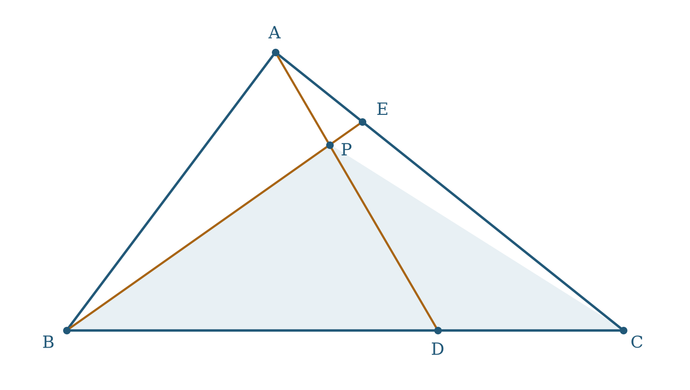
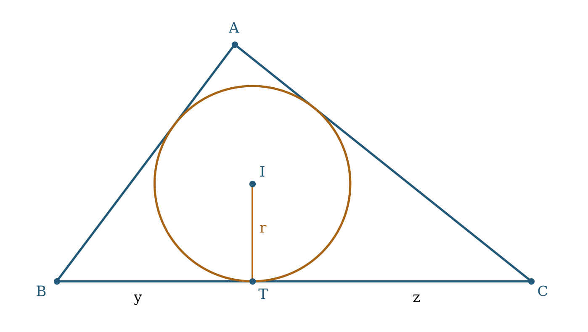
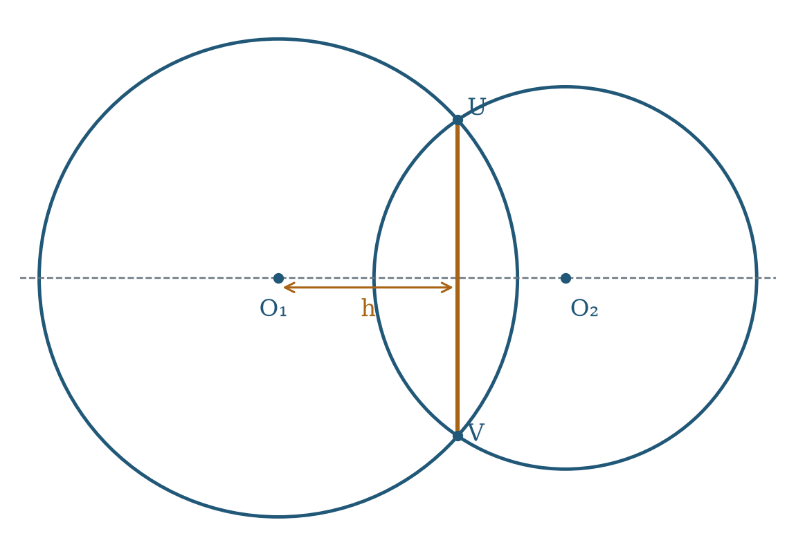
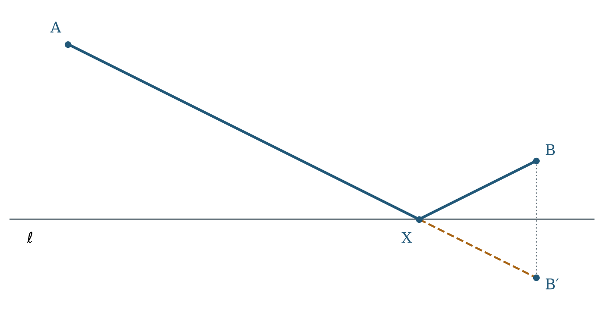
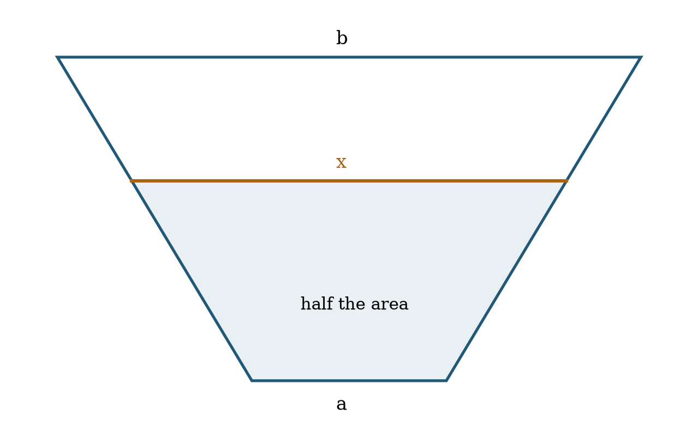

# The geometry behind a short computation

An AIME geometry problem asks for a number, but its difficulty usually lies in finding the right quantities to compute. A coordinate solution can be elegant when its axes encode the symmetry. A synthetic solution can be inefficient when it introduces five auxiliary circles to avoid one quadratic equation. The objective is a proof with few moving parts, not allegiance to a particular language.

This book develops a small set of models that repeatedly convert geometric constraints into manageable equations. Every formula carries its hypotheses. In particular, a solution must distinguish a line from a segment, a circle from a disk, an internal tangency from an external tangency, and a square root from either root of a squared equation. These distinctions are often exactly where a plausible computation ceases to solve the original problem.

Use the companion historical collection as a laboratory. First attempt the problem without its method tags. Then identify the single representation that made the solution short. Finally vary one parameter and decide which parts of the proof still hold. The reusable theorem is more valuable than the numerical answer.

The general results are classical unless identified as an archive-derived formulation. That label describes the synthesis in this project, not a claim of priority. The problem catalog and provenance report specify the historical coverage and the extent of source review.

## A decision table

| Dominant information | First model to try | Quantity to avoid computing prematurely |
|---|---|---|
| Ratios on sides; areas | Similarity, area ratios, affine coordinates | Individual angles |
| Three sides; a cevian | Cosine rule or Stewart's identity | A coordinate system for every point |
| Tangents, secants, intersecting circles | Power of a point; radical axis | Separate coordinates for both intersections |
| Incircle and side lengths | Tangent lengths and semiperimeter | The incenter's Cartesian coordinates |
| Many right angles or distances | Dot products and subtraction of squared distances | Every square root |
| One distinguished circle | Unit-circle complex coordinates | Trigonometric expansions in several angles |
| Two circles through one point | Inversion centered at that point | General equations for both circles |
| Shortest broken path | Reflection or unfolding | Piecewise derivatives |
| Similar cross sections in a solid | Scale factors and volume ratios | A three-dimensional determinant |

This table suggests a starting point. It never substitutes for checking whether its hypotheses fit.

# 1. Normalize before introducing unknowns

## 1.1 Similarity and dimensions

**Theorem 1.1.** Under a similarity with positive scale factor $k$, lengths multiply by $k$, areas by $k^2$, and volumes by $k^3$. Angles and ratios of like-dimensional quantities are unchanged.

**Proof.** Resolve a segment into orthogonal components: each component scales by $k$, so its length does too. The determinant of two vectors scales by $k^2$, and that of three vectors by $k^3$. Triangulation and tetrahedral decomposition give the assertions for polygonal regions and polyhedra; the same rules pass to limits. $\square$

Normalize a convenient length to one when the requested expression is invariant under scale. If the answer is an area, compute the normalized area and multiply by the square of the removed scale. A statement involving both a length and an area generally does not survive arbitrary normalization unless the dimensions are tracked.

**Diagnostic.** If a proposed formula for a length is $ab/(c+d)$, its dimensions are plausible. If it is $ab/(c^2+d^2)$, it is dimensionless. A dimensional check cannot prove a formula, but it can reject one immediately.

## 1.2 Choose an origin that removes a constraint

For a triangle with base $BC=a$, take $B=(0,0)$, $C=(a,0)$, and $A=(u,v)$ with $v>0$. If $AB=c$ and $AC=b$, then subtraction gives

$$u=\frac{a^2+c^2-b^2}{2a},\qquad v^2=c^2-u^2.$$

This is often better than solving two circle equations simultaneously. Keep $v^2$ rather than $v$ until a quantity genuinely needs the altitude. For an isosceles triangle, place the origin at the base midpoint; then the apex has horizontal coordinate zero. For a rectangle, place axes along its sides. For a circle, put its center at the origin.

**Derived principle 1.2 (subtract before solving).** Equal-distance constraints share quadratic terms. Subtracting them usually gives a line or plane before any square root is taken.

This principle is the common source of perpendicular bisectors, radical axes, circumcenter equations, and many spatial distance calculations.

# 2. Areas encode ratios

Write $[ABC]$ for the nonnegative area of a triangle. Use oriented determinants when a point lies outside a triangle; do not silently carry an internal area formula across a side.

**Lemma 2.1.** Triangles with a common altitude have areas proportional to their bases. Triangles with a common base have areas proportional to their altitudes.

**Proof.** Both assertions follow from $[ABC]=\tfrac12 bh$. $\square$

**Theorem 2.2 (internal angle bisector).** If $D$ lies on $BC$ and $AD$ bisects $\angle BAC$, then

$$\frac{BD}{DC}=\frac{AB}{AC}.$$

**Proof.** On one hand, $[ABD]/[ACD]=BD/DC$. On the other, the common factor $\tfrac12 AD\sin\angle BAD$ cancels from the two area formulas, leaving $AB/AC$. $\square$

**Theorem 2.3 (Ceva, internal form).** For $D\in BC$, $E\in CA$, and $F\in AB$, all in the interiors of their sides, the cevians $AD,BE,CF$ are concurrent if and only if

$$\frac{BD}{DC}\frac{CE}{EA}\frac{AF}{FB}=1.$$

**Proof.** If they meet at $P$, divide the triangle into the six triangles around $P$. Pairs with a common altitude give $BD/DC=[PBD]/[PCD]$, and the corresponding ratios around the other vertices multiply to one after expressing the three large triangles $[PBC],[PCA],[PAB]$.

For a direct algebraic verification and converse, assign positive weights $\alpha,\beta,\gamma$ to $A,B,C$. The point

$$P=\frac{\alpha A+\beta B+\gamma C}{\alpha+\beta+\gamma}$$

lies on the cevian through the point $D=(\beta B+\gamma C)/(\beta+\gamma)$, whose ratio is $BD/DC=\gamma/\beta$. The other two ratios are $\alpha/\gamma$ and $\beta/\alpha$. Conversely, a product of one lets us choose consistent positive weights, producing the common point. $\square$

## 2.1 A cevian-intersection template

Suppose $D=(1-t)B+tC$ and $E=(1-u)C+uA$, with $0<t,u<1$. To find $P=AD\cap BE$, write

$$P=(1-\lambda)A+\lambda[(1-t)B+tC]
=(1-\mu)B+\mu[(1-u)C+uA].$$

Equate the coefficients of $A,B,C$, remembering that their coefficients sum to one. This is a two-variable linear problem. The coefficient of $A$ in $P$ is also $[PBC]/[ABC]$. Thus an intersection-area problem can be finished without obtaining a single Cartesian coordinate.

**Worked example.** If $BD:DC=2:1$ and $CE:EA=3:1$, take weights $\alpha:\beta:\gamma=6:1:2$. Then $P$ has normalized weights $(6,1,2)/9$, so $[PBC]/[ABC]=2/3$. The third concurrent cevian meets $AB$ in ratio $AF:FB=1:6$.

{width=75%}

The weights are an encoding of affine ratios. They are not physical masses that permit an arbitrary division rule: prove or recall the weighted-point identity before using them.

## 2.2 Parallel sections through one interior point

**Derived theorem 2.4.** Let $P$ have positive normalized affine weights $\lambda_A,\lambda_B,\lambda_C$ in triangle $ABC$. The full section of the triangle through $P$ parallel to side $a=BC$ has length $d_A=a(1-\lambda_A)$. Consequently

$$\frac{d_A}{a}+\frac{d_B}{b}+\frac{d_C}{c}=2.$$

**Proof.** The triangle above the section is similar to $ABC$. The altitude of $P$ above $BC$ is $\lambda_A$ times the altitude of $A$, so the smaller triangle's altitude and base ratios are $1-\lambda_A$. Sum and use $\lambda_A+\lambda_B+\lambda_C=1$. $\square$

If all three full sections have the same length $d$, then

$$d=\frac2{1/a+1/b+1/c}.$$

Such an interior point exists exactly when $d<\min(a,b,c)$: the weights $1-d/a,1-d/b,1-d/c$ must all be positive, and when they are, they sum to one and construct the point. This existence test is essential in the setting of 1986-A-09.

**Derived proposition 2.5 (cevian length ratios).** If $AD,BE,CF$ concur at an interior point $P$ and $x=AP/PD$, $y=BP/PE$, $z=CP/PF$, then

$$\frac1{1+x}+\frac1{1+y}+\frac1{1+z}=1,
\qquad xyz=x+y+z+2.$$

**Proof.** Along $AD$, the affine weight of $A$ at $P$ is $PD/AD=1/(1+x)$. The three weights sum to one. Clearing the positive denominators gives the cubic identity. $\square$

**Historical use.** In 1988-A-12, equal terminal lengths $PD=PE=PF=d$ turn the identity into $AP\cdot BP\cdot CP=d^2(AP+BP+CP)+2d^3$. A metric-looking problem is controlled by affine areas.

# 3. Triangle metric identities

Throughout this chapter, $a=BC$, $b=CA$, $c=AB$, $s=(a+b+c)/2$, $\Delta=[ABC]$, and the triangle is nondegenerate.

**Theorem 3.1 (cosine and sine rules).**

$$a^2=b^2+c^2-2bc\cos A,\qquad \frac a{\sin A}=\frac b{\sin B}=\frac c{\sin C}=2R.$$

**Proof.** The first formula is the squared norm of the difference of the two side vectors at $A$. For the second, a chord subtending an inscribed angle $A$ has length $2R\sin A$; the supplementary central-angle case gives the same sine. $\square$

**Theorem 3.2 (Stewart).** If $BD=m$, $DC=n$, $m+n=a$, and $AD=d$, then

$$d^2=\frac{n c^2+m b^2}{a}-mn.$$

**Proof.** Put $B=0$, $C=a$ on a horizontal axis and $A=(u,v)$. Then $c^2=u^2+v^2$, $b^2=(u-a)^2+v^2$, and $d^2=(u-m)^2+v^2$. Substitution and cancellation prove the formula. $\square$

**Corollaries.** The median to side $a$ has squared length

$$m_a^2=\frac{2b^2+2c^2-a^2}{4}.$$

The internal angle bisector from $A$ has squared length

$$\ell_a^2=bc\left(1-\frac{a^2}{(b+c)^2}\right).$$

For the second formula, use $m=ac/(b+c)$ and $n=ab/(b+c)$ in Stewart. This derivation is safer than recalling the formula without its side labels.

**Theorem 3.3 (Heron and the radii).**

$$\Delta^2=s(s-a)(s-b)(s-c),\qquad r=\frac\Delta s,\qquad R=\frac{abc}{4\Delta}.$$

**Proof.** From $\Delta=bc\sin A/2$ and the cosine rule,

$$16\Delta^2=4b^2c^2-(b^2+c^2-a^2)^2
=((b+c)^2-a^2)(a^2-(b-c)^2).$$

Factoring its four linear terms gives Heron. Joining the incenter to the vertices partitions the triangle into three triangles of heights $r$, so $\Delta=rs$. Finally the sine rule in $\Delta=bc\sin A/2$ yields the formula for $R$. $\square$

**Shortening rule.** If all sides are given, calculate $\Delta^2$ before $\Delta$. If the requested quantity is $r^2$, use $\Delta^2/s^2$ and never introduce a radical. If the requested quantity is $Rr$, use $abc/(4s)$.

# 4. Tangent lengths and the incircle

## 4.1 The positive variables that build a triangle

Let the tangent lengths from $A,B,C$ to the incircle be $x,y,z$. Equality of tangents from a point gives

$$a=y+z,\qquad b=z+x,\qquad c=x+y,\qquad s=x+y+z.$$

Conversely any positive $x,y,z$ define side lengths satisfying the strict triangle inequalities. This substitution turns all three triangle inequalities into positivity.

{width=75%}

**Proposition 4.1.** In these variables,

$$\Delta^2=(x+y+z)xyz,\qquad r^2=\frac{xyz}{x+y+z},\qquad
\tan\frac A2=\frac r x.$$

**Proof.** The first two formulas are Heron and $r=\Delta/s$. The last comes from the right triangle formed by $A$, the incenter, and the tangency point on $AB$. $\square$

**Worked example.** If the tangency lengths are $2,3,6$, the sides are $9,8,5$, $s=11$, and $r^2=36/11$. No coordinate system or angle computation is needed.

For an excircle opposite $A$, the exradius is $r_a=\Delta/(s-a)$. This follows by adding the two exterior triangles along $AB,AC$ and subtracting the one along $BC$: their signed area sum is $r_a(b+c-a)/2$. Be careful about the side extensions; the tangency point need not lie on the same segment as for the incircle.

## 4.2 Incenter distances without coordinates

**Lemma 4.2.** $AI^2=r^2+(s-a)^2$.

**Proof.** The right triangle from the preceding proposition has legs $r$ and the tangent length $s-a$. $\square$

This identity is particularly effective when distances from the incenter to vertices are given. Subtract two such squared equations to eliminate $r^2$; then reconstruct $x,y,z$ and use Proposition 4.1. Do not introduce three independent angles when three positive tangent lengths already encode the triangle.

# 5. Power of a point and radical axes

**Definition.** For a circle of center $O$ and radius $R$, the power of $P$ is $\operatorname{Pow}(P)=PO^2-R^2$. It is positive outside, zero on, and negative inside the circle.

**Theorem 5.1 (directed secant identity).** If a line through $P$ intersects the circle at $U,V$, with signed distances $t_1,t_2$ along a chosen unit direction, then $t_1t_2=\operatorname{Pow}(P)$.

**Proof.** Substitute $P+t\mathbf v$ into $|P+t\mathbf v-O|^2=R^2$, where $|\mathbf v|=1$. The quadratic is

$$t^2+2\mathbf v\cdot(P-O)t+PO^2-R^2=0.$$

Its root product is the constant term. $\square$

For an exterior point this yields $PU\cdot PV=PT^2$ for a tangent $PT$. For intersecting chords at an interior point, opposite directed signs cancel to give equality of the two positive products. These are the same theorem, not separate tricks.

**Theorem 5.2 (radical axis).** The equal-power locus of two circles with distinct centers is a line perpendicular to the line of centers. If the circles intersect, this line passes through their two common points.

**Proof.** Subtract $|X-O_1|^2-R_1^2$ and $|X-O_2|^2-R_2^2$. The $|X|^2$ terms cancel, leaving a nonconstant linear equation with normal vector $O_2-O_1$. Common points have zero power to both. $\square$

**Derived template 5.3 (common-chord coordinates).** For centers $(0,0)$ and $(d,0)$, $d>0$, radii $R,r$, the common chord lies on

$$x=h=\frac{R^2-r^2+d^2}{2d}.$$

Its half-length is $\sqrt{R^2-h^2}$ when that radicand is positive. A zero radicand gives tangency. A negative radicand means there are no real intersections; retaining that root would solve only an algebraic extension of the geometry.

{width=80%}

**Corollary 5.4 (radical center).** For three circles with pairwise distinct centers, if two of their radical axes have a unique intersection $P$, the third radical axis also contains $P$.

**Proof.** Equalities of powers are transitive. $\square$

The qualification matters: parallel radical axes need not have a finite common point. Concentric circles of different radii have no equal-power locus.

# 6. A single quadratic identity unifies centers

**Theorem 6.1 (weighted squared-distance identity).** Let $s=\alpha+\beta+\gamma\ne0$ and $X=(\alpha A+\beta B+\gamma C)/s$. For any point $P$,

$$|X-P|^2=\frac{\alpha|A-P|^2+\beta|B-P|^2+\gamma|C-P|^2}{s}
-\frac{\beta\gamma a^2+\gamma\alpha b^2+\alpha\beta c^2}{s^2}.$$

The coefficients may be real; positivity is required only when interpreting $X$ as an interior weighted average.

**Proof.** Translate $P$ to the origin. Expand the squared norm of $\alpha A+\beta B+\gamma C$ and replace $2A\cdot B$ by $|A|^2+|B|^2-c^2$, with its cyclic companions. $\square$

**Corollary 6.2 (Euler's incenter identity).** If $O$ is the circumcenter and $I$ the incenter, then

$$OI^2=R^2-2Rr.$$

**Proof.** Area ratios give the incenter's weights $a:b:c$. Take $P=O$ in Theorem 6.1. Since all vertex distances to $O$ equal $R$,

$$OI^2=R^2-\frac{abc(a+b+c)}{(a+b+c)^2}
=R^2-\frac{abc}{2s}=R^2-2Rr.$$

Here $abc=4R\Delta=4Rrs$. $\square$

It follows that $R\ge2r$, with equality exactly when $I=O$, which forces equal distances from the center to the three chords and hence an equilateral triangle. The inequality is thus a geometric consequence of a squared distance, with a clear equality case.

**Corollary 6.3 (centroid).** If $G=(A+B+C)/3$, then $OG^2=R^2-(a^2+b^2+c^2)/9$.

These formulas are instances of one identity. Remembering the identity reduces the number of unrelated center formulas that must be memorized.

# 7. Cyclic quadrilaterals: angle information becomes algebra

All quadrilaterals in this chapter are convex and have their vertices named in boundary order. Changing the order can change a sum to a difference.

**Theorem 7.1 (cyclic criterion).** Four distinct points $A,B,C,D$ are concyclic if and only if $\angle ABC+\angle ADC=180^\circ$.

**Proof.** On a circle, the two angles intercept complementary arcs $AC$, giving the forward implication. Conversely, the circle through $A,B,C$ has a unique arc on the opposite side of $AC$ on which the inscribed angle is the required supplement. The locus theorem follows, for example, by fixing $AC$ and applying the sine rule to a triangle with the prescribed angle; its circumradius and center side are fixed. Thus $D$ lies on that circle. $\square$

The directed version says that $\angle(AB,CB)=\angle(AD,CD)$ modulo $180^\circ$. It avoids repeatedly distinguishing which side of a chord a point occupies. If directed angles are unfamiliar, explicitly draw and check the relevant convex configuration rather than using unsigned angles indiscriminately.

**Theorem 7.2 (Ptolemy).** In a cyclic quadrilateral,

$$AC\cdot BD=AB\cdot CD+AD\cdot BC.$$

**Proof.** Let $E$ be the point on $AC$ such that $\angle ABE=\angle CBD$. The equality of angles subtended by a chord gives $\triangle ABE\sim\triangle DBC$, so $AE\cdot BD=AB\cdot CD$. The remaining angles give $\triangle EBC\sim\triangle ABD$, so $EC\cdot BD=BC\cdot AD$. Add the identities. Convexity places $E$ on the segment $AC$. $\square$

**Theorem 7.3 (Brahmagupta).** A cyclic quadrilateral with side lengths $a,b,c,d$ and semiperimeter $s$ has area $K$ satisfying

$$K^2=(s-a)(s-b)(s-c)(s-d).$$

**Proof.** Split along a diagonal. If the angles between $a,b$ and between $c,d$ are $B,D$, then $D=\pi-B$ and

$$2K=(ab+cd)\sin B.$$

Equating the two cosine-rule expressions for the diagonal gives

$$2(ab+cd)\cos B=a^2+b^2-c^2-d^2.$$

Eliminate $\cos B$ using $\sin^2B=1-\cos^2B$. The difference of squares factors into the four terms $2(s-a),2(s-b),2(s-c),2(s-d)$, proving the claim. $\square$

**Failure test.** Four given side lengths do not determine a general quadrilateral's area. Brahmagupta needs cyclicity. If cyclicity is only suggested by a picture, prove it first.

**Lemma 7.4 (orthogonal diagonals).** For any quadrilateral in boundary order, its diagonals are perpendicular if and only if

$$AB^2+CD^2=BC^2+DA^2.$$

**Proof.** Expanding squared distances gives

$$AB^2+CD^2-BC^2-DA^2=2(A-C)\cdot(D-B).$$

The right side vanishes exactly when the two nonzero diagonal vectors are perpendicular. $\square$

This criterion is independent of cyclicity. When both properties hold, the area has two useful expressions: $K=AC\cdot BD/2$ and Brahmagupta's formula. Choose the expression involving the quantities already known.

# 8. Vectors and distances: linearize the metric

## 8.1 The dot product as the coordinate-free cosine rule

For vectors $u,v$, $u\cdot v=|u||v|\cos\theta$. In the plane the determinant $u\times v=u_xv_y-u_yv_x$ is the oriented area scale. Thus

$$u\perp v\iff u\cdot v=0,\qquad
u\parallel v\iff u\times v=0,\qquad
[ABC]=\frac12|(B-A)\times(C-A)|.$$

Choosing vectors along two oblique sides can be shorter than forcing orthogonal coordinates. If $u\cdot v$ is known, every distance involving $pu+qv$ follows from

$$|pu+qv|^2=p^2|u|^2+2pq(u\cdot v)+q^2|v|^2.$$

## 8.2 The distance-difference plane

**Proposition 8.1.** If the squared distances from an unknown point $X$ to known points $A_i$ are $d_i^2$, subtracting the equation for $A_0$ gives

$$2X\cdot(A_i-A_0)=|A_i|^2-|A_0|^2+d_0^2-d_i^2.$$

Consequently two independent differences determine $X$ in the plane, and three independent differences determine it in space. The remaining original distance equation checks existence.

**Proof.** Expand $|X-A_i|^2=d_i^2$ and subtract. The common $|X|^2$ term disappears. $\square$

**Worked example.** A point $P=(x,y)$ has distances $5,\sqrt{17},\sqrt{13}$ from $(0,0),(4,0),(0,4)$. Subtraction gives $8x=24$ and $8y=28$, hence $(x,y)=(3,7/2)$. But $x^2+y^2=85/4\ne25$. The three specified circles have no common point. Solving the linearized equations alone would have produced a fictitious solution.

This deliberately inconsistent example isolates an important habit: the subtracted system is necessary, but one original quadratic must still be checked.

## 8.3 The rectangle distance identity

**Theorem 8.2 (British flag identity).** For a rectangle $ABCD$ and any point $P$ in its plane,

$$PA^2+PC^2=PB^2+PD^2.$$

**Proof.** Use $A=(0,0)$, $B=(u,0)$, $C=(u,v)$, $D=(0,v)$ and expand, or apply Lemma 7.4 to the translated vectors. $\square$

The point need not lie inside the rectangle. If only three vertex distances are given, the fourth squared distance follows immediately. Its positivity is necessary but does not alone guarantee that a point with all four distances exists.

## 8.4 Projection without a diagram guess

For a nonzero vector $v$, the squared distance from $P$ to the line $A+t v$ is

$$|P-A|^2-\frac{((P-A)\cdot v)^2}{|v|^2}.$$

The minimizing parameter is $t=((P-A)\cdot v)/|v|^2$. For the segment from $A$ to $A+v$, that parameter must lie in $[0,1]$; otherwise the closest point is an endpoint. A line-distance formula used on a segment is a common source of extraneous geometric answers.

# 9. Complex coordinates on a circle

Complex numbers are most effective when the circle is built into the coordinates. Represent a point by $z=x+iy$ and normalize the distinguished circle to $|z|=1$. Then $\bar z=1/z$ for its points.

**Lemma 9.1.** Three distinct points $a,b,c$ are collinear exactly when $(c-a)/(b-a)$ is real. Two nonzero directed segments are perpendicular exactly when their complex ratio is purely imaginary.

**Proof.** The argument of a quotient is the difference of directions. Real quotients have angle $0$ modulo $\pi$, and purely imaginary quotients have angle $\pi/2$ modulo $\pi$. $\square$

**Theorem 9.2 (chord equation).** If $a,b$ are distinct points on the unit circle, the line through them is

$$z+ab\bar z=a+b.$$

**Proof.** Both endpoints satisfy the equation using $a\bar a=b\bar b=1$. Writing $z=x+iy$ shows it is one real linear constraint after multiplying by a suitable unit complex number. It is therefore the line through the endpoints. Alternatively, expand the reality condition in Lemma 9.1. $\square$

**Corollary 9.3 (tangent).** The tangent at $a$ is $z+a^2\bar z=2a$, equivalently $\operatorname{Re}(z\bar a)=1$.

**Theorem 9.4 (reflection across a unit-circle chord).** Reflection in the line through $a,b$ sends $z$ to

$$z'=a+b-ab\bar z.$$

**Proof.** The map fixes every point on the chord line by Theorem 9.2. Its conjugate-linear coefficient has modulus one, so it preserves distances and reverses orientation. It is therefore reflection in that fixed line. $\square$

This gives the foot of a perpendicular as $(z+z')/2$. It also gives the orthocenter of a triangle on the unit circle: $h=a+b+c$, since

$$\frac{h-a}{b-c}=\frac{b+c}{b-c}$$

is purely imaginary for $|b|=|c|=1$. Its conjugate is its negative, which verifies the assertion without trigonometry.

## 9.1 Roots of unity and regular polygons

For a regular $n$-gon centered at zero, vertices can be written $R\zeta^j$, where $\zeta=e^{2\pi i/n}$. A chord spanning $k$ steps has length

$$R|1-\zeta^k|=2R\sin\frac{k\pi}{n}.$$

The identity $1+\zeta+\cdots+\zeta^{n-1}=0$ is a geometric centroid statement and an algebraic geometric sum. Use symmetry to combine conjugate terms before expanding real and imaginary parts. A diagonal ratio often depends only on two sine values, so the radius cancels.

# 10. Inversion: remove a circle through the origin

**Definition.** Inversion of radius $\rho>0$ centered at $O$ maps $P\ne O$ to the point $P'$ on ray $OP$ with $OP\cdot OP'=\rho^2$. With $O$ as the vector origin,

$$P'=\frac{\rho^2P}{|P|^2}.$$

**Theorem 10.1 (distance transformation).**

$$P'Q'=\frac{\rho^2\,PQ}{OP\,OQ}.$$

**Proof.** Square the difference of the two vector formulas and factor $|P|^2+|Q|^2-2P\cdot Q=|P-Q|^2$. $\square$

**Theorem 10.2 (circle-line transformation).** A circle through $O$, excluding $O$, maps to a line not through $O$. A line not through $O$ maps to a circle through $O$. A circle not through $O$ maps to a circle.

**Proof.** Write a generalized circle equation as

$$\alpha|X|^2+u\cdot X+v=0.$$

Substitute $X=\rho^2X'/|X'|^2$ and multiply by $|X'|^2$:

$$v|X'|^2+\rho^2u\cdot X'+\alpha\rho^4=0.$$

The constant term of the original equation vanishes exactly when its circle passes through $O$, and then the image equation is linear. The other cases follow in the same way, with the excluded center handled separately. $\square$

**Lemma 10.3 (angle preservation in magnitude).** Inversion preserves the magnitude of the angle between intersecting smooth curves, while reversing its orientation.

**Proof.** At a nonzero vector $X$, its derivative is a positive scalar multiple of the reflection that reverses the radial component and preserves the perpendicular component. Reflections preserve angle magnitudes. A direct circle-tangent proof gives the same result. $\square$

**When it shortens a solution.** Invert about a point shared by several circles: they become lines. Pick $\rho^2$ equal to a known product when that makes a relevant pair exchange or fixes a useful circle. Write down which points are excluded and how lengths transform before computing the requested metric quantity. Inversion preserves angles, not lengths, areas, or the interior side of every circle.

# 11. Trigonometry with one parameter

## 11.1 Products and ratios before angles

If a right triangle gives $\sin\theta=3/5$ and $0<\theta<\pi/2$, use $\cos\theta=4/5$ directly. There is no reason to calculate $\theta$. For two angles, use

$$\cos(\alpha\pm\beta)=\cos\alpha\cos\beta\mp\sin\alpha\sin\beta.$$

The signs are determined by the original angle intervals. Replacing a cosine by a square root without its sign can select the wrong configuration.

**Proposition 11.1 (half-angle rationalization).** With $t=\tan(\theta/2)$ and $\theta\not\equiv\pi\pmod{2\pi}$,

$$\cos\theta=\frac{1-t^2}{1+t^2},\qquad \sin\theta=\frac{2t}{1+t^2}.$$

**Proof.** Apply the double-angle formulas to $\theta/2$ and divide numerator and denominator by $\cos^2(\theta/2)$. $\square$

This parameter turns a single-angle geometric equation into a rational equation. The missing point $\theta=\pi$ must be checked separately if the geometry allows it. For an internal triangle angle, $t>0$, which removes many extraneous algebraic roots immediately.

## 11.2 The chord-height template

**Proposition 11.2.** A chord of half-length $a$ at perpendicular distance $h$ from a circle center of radius $R$ satisfies $a^2+h^2=R^2$.

When several parallel chords are present, choose their signed heights relative to the center. Differences of their squared half-lengths give differences of squared heights. If the chord separation is $d$ and the heights are $h,h+d$, then

$$a^2-b^2=(h+d)^2-h^2=2dh+d^2.$$

The unknown center offset is obtained linearly. Deciding which side of the center each chord lies on is part of the geometry, not a cosmetic sign convention.

## 11.3 The angular size of a circle

**Derived proposition 11.3.** From a point $P$ at distance $d>r$ from a circle center $O$, the largest angle between $PO$ and a ray meeting the circle is the tangent angle $\theta$, where

$$\sin\theta=\frac rd,\qquad \tan^2\theta=\frac{r^2}{d^2-r^2}.$$

**Proof.** The extreme ray is tangent: a secant ray can rotate farther from the center ray until its two intersections coalesce. At the tangency point $T$, $OT\perp PT$, so the right triangle $POT$ gives the formulas. Equivalently, the distance from $O$ to the ray's line must be at most $r$, with a positive projection onto the ray. $\square$

**Historical use.** The extremum in 2014-I-07 is an angular-visibility problem. Tangency turns an optimization over points on a circle into one right triangle.

## 11.4 Rolling circles: distinguish two rotations

**Proposition 11.4.** A disk of radius $r$ rolls without slipping around the outside of a fixed disk of radius $R$. When its line of centers turns through angle $\alpha$, its spin relative to the fixed plane is $(R+r)\alpha/r$.

**Proof.** The moving center travels an arc of length $(R+r)\alpha$. At the contact point, zero instantaneous velocity means that the tangential speed of the center equals $r$ times the spin speed. Integrating gives the formula. An equivalent arc comparison gives relative spin $R\alpha/r$ with respect to the rotating line of centers; the line itself contributes an additional $\alpha$. $\square$

**Historical use.** In 2014-I-10, confusing spin relative to the moving radius with spin relative to the plane loses exactly this extra turn. Decide what the marked point is measured against before counting rotations.

## 11.5 A triple-angle test for a triangle

**Derived proposition 11.5.** For positive triangle angles $A,B,C$, the equality $\cos3A+\cos3B+\cos3C=1$ holds exactly when one angle is $120^\circ$.

**Proof.** Put $x=3A$, $y=3B$ and use $3C=3\pi-x-y$. Product-to-sum gives

$$\cos x+\cos y-\cos(x+y)-1
=4\sin(x/2)\sin(y/2)\cos((x+y)/2).$$

Since $0<A,B<\pi$ and $0<A+B<\pi$, its factors vanish only at $A=2\pi/3$, $B=2\pi/3$, or $A+B=\pi/3$, the last equivalent to $C=2\pi/3$. The formal endpoint $A+B=\pi$ is excluded by $C>0$. $\square$

**Historical use.** This is the structural reduction in 2014-II-12. Once an angle is $120^\circ$, the cosine rule becomes $c^2=a^2+b^2+ab$ for its opposite side, replacing a three-angle equation by a quadratic relation among lengths.

# 12. Reflection, unfolding, and extrema

**Theorem 12.1 (one reflection).** For points $A,B$ on the same side of a line $\ell$, the shortest path from $A$ to $B$ through a point of $\ell$ is found by reflecting $B$ to $B'$ and intersecting segment $AB'$ with $\ell$.

**Proof.** For every $X\in\ell$, $XB=XB'$. The triangle inequality gives $AX+XB'=AX+XB\ge AB'$, with equality when $A,X,B'$ are collinear in that order. The stated intersection exists because $A$ and $B'$ lie on opposite sides. $\square$

If the reflection point is restricted to a segment, check that the intersection lies on that segment. If it does not, the minimum occurs at an endpoint; the unrestricted reflection solution is infeasible.

{width=80%}

**Theorem 12.2 (unfolding planar faces).** A path crossing a prescribed sequence of faces of a polyhedron can be unfolded into their common plane without changing its length. Its shortest candidate is a straight segment, provided that segment crosses the required edges in the prescribed order and inside their segments.

**Proof.** Rotation of a face about a common edge is an isometry. After unfolding each face, apply the planar triangle inequality. Equality requires a straight path, and the edge conditions are exactly what makes that planar segment correspond to the proposed surface path. $\square$

**Box template.** Between opposite vertices of a box with side lengths $a,b,c$, the three two-face unfoldings give candidates

$$\sqrt{(a+b)^2+c^2},\quad \sqrt{(a+c)^2+b^2},\quad \sqrt{(b+c)^2+a^2}.$$

A proof that these cover the shortest path must account for the permitted faces and endpoints in the particular problem. A list of nets is not itself an exhaustion argument for an arbitrarily constrained surface path.

## 12.1 Maximize an area with its equality case

For fixed sides $b,c$ enclosing an angle, $\Delta=bc\sin A/2\le bc/2$, with equality exactly when $A=90^\circ$. For fixed perimeter, Heron plus AM-GM gives

$$\Delta^2=s(s-a)(s-b)(s-c)\le s\left(\frac s3\right)^3,$$

with equality exactly at $a=b=c$. The proof identifies both the bound and a feasible shape attaining it. If another constraint prevents the equality case, the displayed bound is not the desired maximum.

# 13. Solid geometry: reduce dimension deliberately

## 13.1 Cross sections and similar solids

**Theorem 13.1.** A plane parallel to the base of a pyramid or cone cuts a smaller similar solid. If its distance from the apex is a fraction $t$ of the original altitude, then corresponding lengths, section area, and enclosed volume scale as $t,t^2,t^3$.

**Proof.** Every ray from the apex meets the parallel planes in the same ratio. This is a homothety centered at the apex; apply Theorem 1.1. $\square$

Thus a plane cutting off a fraction $q$ of the volume has altitude ratio $q^{1/3}$, not $q$. A frustum of height $h$ with parallel similar bases of areas $A,B$ has volume

$$V=\frac h3(A+\sqrt{AB}+B).$$

To derive it, subtract the volumes of two similar cones or pyramids. The scale ratio is $\sqrt{B/A}$, so the resulting cubic difference factors into the displayed expression. The cylinder/prism case is the limit $A=B$, giving $Ah$.

## 13.2 Sphere sections and tangency

A plane at distance $d\le R$ from a sphere center cuts a circle of radius $\sqrt{R^2-d^2}$. This is a right-triangle statement in a plane through the center and a point of the section. Two externally tangent spheres of radii $r_1,r_2$ have center distance $r_1+r_2$; internal tangency gives $|r_1-r_2|$.

When several spheres lie on the same side of and touch a common plane, their centers have heights equal to their radii. For two externally tangent spheres in this configuration, the horizontal separation $s$ of their centers therefore satisfies

$$s^2=(r_1+r_2)^2-(r_1-r_2)^2=4r_1r_2.$$

The same formula describes two externally tangent circles lying on the same side of and tangent to a common line. It is often the missing simplification in a chain of tangent circles: horizontal gaps are $2\sqrt{r_1r_2}$, so square-root radii can be more natural variables than radii.

## 13.3 Tetrahedral volume and a Gram determinant

Let the three edge vectors at one vertex be $u,v,w$. The tetrahedron's volume is

$$V=\frac{|\det(u,v,w)|}{6},\qquad
36V^2=\det\begin{pmatrix}
u\cdot u&u\cdot v&u\cdot w\\
v\cdot u&v\cdot v&v\cdot w\\
w\cdot u&w\cdot v&w\cdot w
\end{pmatrix}.$$

**Proof.** The determinant is the oriented parallelepiped volume. The tetrahedron is one sixth of that volume. The second equation is $\det(M^{\mathsf T}M)=\det(M)^2$ for the matrix with columns $u,v,w$. $\square$

All dot products can be reconstructed from the six edge lengths using the cosine rule. A negative determinant means those edge lengths cannot form a real tetrahedron with the assumed labels. For realizable edge data, zero means degeneracy. Conversely, a nonnegative determinant alone does not certify realizability: the whole Gram matrix must be positive semidefinite, or positive definite for a nondegenerate tetrahedron. If a right-angle structure is present, use it before expanding a determinant.

## 13.4 Volume from two faces and their common edge

**Derived proposition 13.2.** Two faces of a tetrahedron share an edge of length $c$, have areas $K_1,K_2$, and form dihedral angle $\theta$. Its volume is

$$V=\frac{2K_1K_2\sin\theta}{3c}.$$

**Proof.** Their altitudes to the common edge have lengths $h_1=2K_1/c$ and $h_2=2K_2/c$. The height of the second apex above the first face is $h_2\sin\theta$. Thus $V=K_1h_2\sin\theta/3$. $\square$

The two altitude feet need not coincide, and neither face needs to be isosceles. In 1984-A-09 this formula computes the desired volume directly from face information; introducing every edge length would be unnecessary.

\newpage

## 13.5 An affine law for radii between tangent planes

**Derived theorem 13.3 (affine radii, with converse).** Let a nonempty finite family of spheres have positive radii $r_i$ and touch $z=0$ from above at $(x_i,y_i,0)$. They also touch a distinct plane, all on the same side of it, if and only if there is an affine function

$$r_i=ax_i+by_i+c$$

valid at all their contact points. In particular, three noncollinear contact points and their radii determine the radius at any further contact point.

**Proof.** Orient the second plane's unit normal $(A,B,C)$ so that all sphere centers have positive signed distance from it. If its equation is $Ax+By+Cz+D=0$, tangency at center $(x_i,y_i,r_i)$ gives

$$Ax_i+By_i+(C-1)r_i+D=0.$$

If $C=1$, the unit-normal condition forces $A=B=0$, and this equation forces $D=0$, making the plane $z=0$. Thus $C\ne1$, and solving for $r_i$ gives the affine law.

Conversely, suppose the affine law holds and put $q=a^2+b^2$. Consider the plane

$$2ax+2by+(q-1)z+2c=0.$$

Its normal has length $\sqrt{4q+(q-1)^2}=q+1$. At center $(x_i,y_i,r_i)$ its left side is $(q+1)r_i$, so the signed distance is precisely $r_i>0$. Every sphere is therefore tangent and lies on the same side. The plane is distinct from $z=0$: coincidence would force $a=b=c=0$, contrary to the positive radii. Finally, three noncollinear planar points determine an affine function uniquely. $\square$

**Historical use: 2026-I-12.** Put the three contact points at $(0,0),(6,0),(0,4)$ with radii $1,2,3$. The radius function is immediately $r(x,y)=1+x/6+y/2$. Reflecting their centroid $(2,4/3)$ across $2x+3y=12$ gives $(42/13,124/39)$, so the fourth radius is $122/39$. The converse certifies existence of the second tangent plane; coplanarity of the centers alone should not be used without explaining why it follows from tangency.

# 14. A disciplined shortening procedure

## 14.1 Keep the target visible

If the target is a product of lengths, power of a point may compute it without either factor. If the target is an area ratio, affine weights may compute it without an altitude. If it is a squared distance, stay with squared quantities. A long solution often begins by computing more than the question requires.

**Derived principle 14.1 (eliminate the nuisance scale).** Suppose all constraints except one are invariant under similarity. Solve the shape first using ratios, then use the remaining dimensional constraint to restore scale. A single unknown scale is preferable to several correlated side lengths.

**Derived principle 14.2 (linear constraints first).** Apply parallelism, side ratios, equal powers, and squared-distance differences before solving any circle or sphere equation. A quadratic constrained to a known line is a one-variable problem.

**Derived principle 14.3 (certify a geometric root).** After obtaining an algebraic candidate, check: positivity; triangle inequalities; the specified side of a line; segment membership; internal versus external tangency; and every equation that was squared or subtracted. Only the checks relevant to the construction are needed, but those checks cannot be omitted.

## 14.2 Three comparisons

**Incircle data.** Starting with general coordinates for the vertices and the incenter introduces at least five coupled variables. Tangent lengths immediately give positive variables $x,y,z$ and $r^2=xyz/(x+y+z)$. Use coordinates only if the problem has an additional directional constraint that these variables do not encode.

**Two circle intersections.** Solving two quadratic equations independently creates two radicals and sign choices. Subtract them to find the radical axis, then solve one quadratic on that line. If only the common-chord length is wanted, the chord-height formula finishes even earlier.

**A cevian-area ratio.** Trigonometric area formulas introduce angles that cancel at the end. Affine weights encode the prescribed side ratios and give the area ratio as one coefficient. The important proof is that the coefficient equals the desired signed area.

## 14.3 Proof versus numerical reconnaissance

A scale drawing or numerical solve can suggest the right configuration and detect impossible roots. It cannot prove exact equality, exhaust all branches, or establish a maximum. Use a numerical experiment to discover a structure; then present an exact derivation with its domain. The companion check ledgers state which historical instances received an independent exact calculation.

## 14.4 Three archive-derived compression lemmas

**Proposition 14.4 (a section-length area coordinate).** In a trapezoid with parallel bases $0\le a<b$, a parallel section of length $x$ cuts off a fraction

$$\frac{x^2-a^2}{b^2-a^2}$$

of the area measured from the short base. In particular, the area-bisecting section has length $\sqrt{(a^2+b^2)/2}$.

**Proof.** If the trapezoid has height $h$ and the cut is at height $t$ above the short base, linear interpolation gives $x=a+(b-a)t/h$. The area below the cut is $(a+x)t/2$, and the total is $(a+b)h/2$. Substitute $t/h=(x-a)/(b-a)$. $\square$

**Historical use.** The key step in 2000-II-06 is to use squared section length as the area coordinate. A height computation is unnecessary after this identity is recognized. The limiting case $a=b$ is a rectangle and must be treated separately: every parallel section has the same length.

{width=75%}

**Proposition 14.5 (inradius from four tangent lengths).** In a convex quadrilateral tangent to a circle of radius $r$, let the positive tangent lengths from its four vertices be $a,b,c,d$. Then

$$r^2=\frac{abc+abd+acd+bcd}{a+b+c+d}.$$

**Proof.** If the internal angles are $A,B,C,D$, the tangent-length right triangles give $a/r=\cot(A/2)$ and cyclically. Thus the arguments of $r+ia,r+ib,r+ic,r+id$ are $(\pi-A)/2,(\pi-B)/2,(\pi-C)/2,(\pi-D)/2$. They sum to $\pi$, so their product is real. Its imaginary part is

$$r^3(a+b+c+d)-r(abc+abd+acd+bcd)=0.$$

Divide by the positive $r(a+b+c+d)$. $\square$

**Historical use.** In 2000-II-10 this identity eliminates four angle variables at once. The analogous three-tangent-length formula in Proposition 4.1 comes from a triangle; changing the number of vertices changes the relation and must not be ignored.

**Proposition 14.6 (sphere center to a triangular region).** Suppose a triangle of circumradius $\rho$ lies on a sphere of radius $R$. Let $O$ be its planar circumcenter and $d$ the distance from $O$ to the closed triangular region in that plane. The distance from the sphere center to the triangular region is

$$\sqrt{R^2-\rho^2+d^2}.$$

**Proof.** The orthogonal projection of the sphere center onto the triangle's plane is equidistant from the three vertices, hence is $O$. Its perpendicular distance to the plane is $\sqrt{R^2-\rho^2}$. For every point of the triangular region, Pythagoras splits the squared distance into this fixed term plus its squared planar distance from $O$. Minimize the latter. $\square$

**Historical use.** The projection reduction in 2000-II-12 gives the plane distance immediately. To call it the distance to the triangle, one must additionally show that the circumcenter is inside or on the triangle, so $d=0$. For an obtuse triangle that shortcut can fail.

## 14.5 Affine constructions that preserve the area calculation

**Proposition 14.7 (fan-centroid homothety).** Fix a point $J$ and vertices $V_1,\ldots,V_n$ in order. Let $M_i$ be the midpoint of $V_iV_{i+1}$ and $G_i$ the centroid of $JV_iV_{i+1}$, with cyclic indices. Then the polygon of $G_i$ is the image of the polygon of $M_i$ under homothety centered at $J$ with scale $2/3$. Its area is $4/9$ of the midpoint polygon's area.

**Proof.** The vector identity

$$G_i=\frac{J+V_i+V_{i+1}}3=J+\frac23(M_i-J)$$

holds for each vertex. The area scaling rule then applies; for oriented polygons it applies to signed area as well. $\square$

The construction in **2018-II-09** becomes an area computation in the midpoint polygon. Moving $J$ cannot change the answer because it only translates the resulting centroid polygon.

**Proposition 14.8 (opposite area balance).** In a convex quadrilateral $ABCD$ with diagonals meeting at $P$,

$$[APB]+[CPD]=[BPC]+[DPA]$$

holds exactly when $AP=CP$ or $BP=DP$.

**Proof.** All four areas have the common positive factor $\tfrac12\sin\angle APB$. Their indicated difference is that factor times

$$AP\cdot BP+CP\cdot DP-CP\cdot BP-AP\cdot DP
=(AP-CP)(BP-DP).$$

It vanishes exactly in the stated two cases. $\square$

In **2018-II-12**, this factorization proves that at least one diagonal is bisected. It does not specify which one. A correct solution must keep both cases or justify a symmetry that exchanges them.

## 14.6 Certifying a distance minimum

**Proposition 14.9 (equal-radius balance).** Suppose $v_1,\ldots,v_n$ are vectors with $|v_i|=R>0$ and $\sum_i v_i=0$. Then for every point vector $X$,

$$\sum_{i=1}^n|X-v_i|\ge nR,$$

with equality attained at $X=0$.

**Proof.** The projection of a vector onto a unit vector never exceeds its norm. Thus

$$|X-v_i|\ge(v_i-X)\cdot\frac{v_i}{R}=R-\frac{X\cdot v_i}{R}.$$

Sum and use the zero vector sum. At $X=0$ every distance is $R$, so the bound is attained. $\square$

This supplies a short geometric-median certificate for the tetrahedral configuration of **2017-II-15**. Equal distances from the centroid and a zero vector sum suffice; central symmetry of the set of vertices is not required. The theorem deliberately makes no uniqueness claim, since collinear configurations can have several minimizing points.

**Proposition 14.10 (a sum of hypotenuses).** For fixed positive $c_1,\ldots,c_n$ and positive $a_i$ with $\sum_i a_i=S>0$,

$$\min\sum_i\sqrt{c_i^2+a_i^2}=\sqrt{\left(\sum_i c_i\right)^2+S^2}.$$

Equality holds exactly when all ratios $a_i/c_i$ equal $S/\sum_i c_i$.

**Proof.** Apply the triangle inequality to vectors $(c_i,a_i)$. Their sum is $(\sum_i c_i,S)$, giving the lower bound. Equality in the triangle inequality requires all these nonzero vectors to point in the same direction, equivalently equal ratios. The prescribed ratios give positive $a_i$ with the correct sum, so the minimum is attained. $\square$

This is the attainability step in **1991-A-15**. If a later condition requires the minimum to be an integer, first prove that the bound is achieved on the original domain.

## 14.7 A complete feasibility audit

**Archive clinic: 2016-I-09.** The licensed archive version reviewed in this project places $A$ at one corner of rectangle $AQRS$, $B$ on segment $QR$, and $C$ on segment $RS$, with $AB=40$, $AC=31$, and $\sin\angle BAC=1/5$. It reports area $744$. The following calculation explains why the equality placement behind that number does not satisfy the stated segment conditions. This is a discrepancy in the reviewed archive; an original MAA paper was not independently obtained to establish its historical origin.

Take $A=(0,0)$, $Q=(w,0)$, $R=(w,h)$, $S=(0,h)$ and write

$$B=40(\cos\theta,\sin\theta),\qquad C=31(\cos(\theta+\alpha),\sin(\theta+\alpha)).$$

Here $0\le\theta<\theta+\alpha\le\pi/2$ and $\alpha=\angle BAC$ is acute, so $\cos\alpha=2\sqrt6/5$. The rectangle area is

$$wh=1240\cos\theta\sin(\theta+\alpha)
=620\bigl(\sin(2\theta+\alpha)+1/5\bigr).$$

Its unconstrained upper bound is indeed $744$, reached at $\theta_*=(\pi/2-\alpha)/2$. But $B$ belongs to segment $QR$ only if $40\sin\theta\le31\sin(\theta+\alpha)$, or

$$\tan\theta\le t:=\frac{31}{200-62\sqrt6}.$$

In contrast, $\tan\theta_*=\sqrt6/3>t$. The sine expression is increasing up to $\theta_*$, so the constrained maximum occurs at $\tan\theta=t$, where $B=R$. At this boundary, $C$ has nonnegative coordinates, lies left of $R$, and has height $h$; these facts also follow directly from the displayed coordinates. The maximum is

$$\frac{1600t}{1+t^2}=\frac{248(1600-496\sqrt6)}{2561-992\sqrt6}\approx728.3651.$$

If the side endpoints were excluded, the same number would be a supremum. Either interpretation excludes $744$. The reusable lesson is specific: an upper bound from $\sin u\le1$ must be followed by a check that its equality angle is permitted by every segment condition.

\newpage

## 14.8 An invariant for equiangular pentagons

**Derived proposition 14.11.** Let a convex equiangular pentagon have perimeter $P$, squared side lengths summing to $S$, and squared diagonal lengths summing to $D$. Then

$$P^2=\sqrt5\,(2D-3S).$$

**Proof.** Number the side lengths $a_0,\ldots,a_4$ cyclically, put $\phi=(1+\sqrt5)/2$, and define

$$J=\sum_{i=0}^4 a_i a_{i+1},\qquad K=\sum_{i=0}^4 a_i a_{i+2}.$$

Each interior angle is $108^\circ$, so successive side vectors turn through $72^\circ$. Since $2\cos72^\circ=1/\phi$, summing the squared lengths of sums of two consecutive side vectors gives

$$D=2S+J/\phi.$$

The five side vectors sum to zero. Taking their sum's squared norm and grouping the ten unordered pairs by whether their indices are adjacent gives

$$0=S+J/\phi-\phi K,$$

because $2\cos144^\circ=-\phi$. Thus $J=\phi(D-2S)$ and $K=(D-S)/\phi$. Every unordered pair occurs once in $J+K$, so

$$\begin{aligned}
P^2&=S+2J+2K\\
&=S+2\phi(D-2S)+2(\phi-1)(D-S)\\
&=(2\phi-1)(2D-3S)=\sqrt5\,(2D-3S).
\end{aligned}$$

This proves the identity without determining any individual side. $\square$

**Historical use: 2026-I-14.** The data $S=308$, $D=800$ give $P^2=676\sqrt5$, so the requested sum is $676+5=681$. The crucial second equation is vector closure. Equiangularity does not make the five sides equal, and the desired radical form is not a substitute for this equation.

# 15. Original training problems

These exercises isolate reusable structures rather than reproduce historical contest wording. Prove each answer; do not stop at a numerical approximation.

1. A triangle has sides $13,14,15$. Find $\Delta,r,R$.
2. In a triangle, $BD:DC=2:3$ and $CE:EA=4:1$. If $P=AD\cap BE$, find $[PBC]/[ABC]$.
3. A triangle has $AB=5$, $AC=7$, $BC=8$. Find the square of the median from $A$.
4. For the same triangle, find the square of the internal angle bisector from $A$.
5. Tangency lengths from the vertices to an incircle are $3,4,5$. Find $r^2$ and $Rr$.
6. A point has power $45$ with respect to a circle. One secant has nearer intersection distance $5$. Find its farther intersection distance and the tangent length.
7. Circles of radii $5,4$ have centers distance $3$. Find their common-chord length.
8. A triangle has $R=5$ and $r=2$. Find $OI$.
9. A cyclic quadrilateral has consecutive side lengths $4,5,6,7$. Find its area.
10. A rectangle has $PA=3$, $PB=5$, $PC=7$ for a point $P$ in its plane. Find $PD$.
11. On the unit circle, $a=1$ and $b=i$. Reflect $z=0$ across line $ab$.
12. A triangle on the unit circle has vertices $1,i,-1$. Find its orthocenter.
13. Inversion of radius $2$ centered at the origin acts on the circle $(x-3)^2+y^2=9$. Find the image line.
14. Points $A=(0,3)$ and $B=(8,1)$ must be joined by a path touching the $x$-axis. Find the minimum length and the touching point.
15. A plane parallel to a cone's base cuts off one eighth of its volume at the apex. What fraction of the cone's height lies below the plane?
16. Two circles of radii $1$ and $9$ are externally tangent and tangent to the same line on the same side. Find the distance between their tangency points on the line.
17. A tetrahedron has three mutually perpendicular edges of lengths $3,4,5$ at one vertex. Find its volume and the area of the opposite face.
18. Prove that for any triangle and any point $P$, $PA^2+PB^2+PC^2=3PG^2+(a^2+b^2+c^2)/3$, where $G$ is the centroid.
19. A line cuts a circle in a chord of length $12$. Moving the line parallel to itself by $2$ toward the center gives a chord of length $16$, without passing the center. Find the radius.
20. An internal point has affine weights $2:3:5$ in a triangle of circumradius $R$ and side lengths $a,b,c$. Express its squared distance to the circumcenter.

# 16. Exercise solutions

1. $s=21$, so $\Delta^2=21\cdot8\cdot7\cdot6=7056$. Thus $\Delta=84$, $r=4$, and $R=13\cdot14\cdot15/(4\cdot84)=65/8$.
2. Choose weights $\alpha:\beta:\gamma=8:3:2$. They give $\gamma/\beta=2/3$ and $\alpha/\gamma=4$. The requested area fraction is $8/13$.
3. Stewart with equal halves gives $(2\cdot25+2\cdot49-64)/4=21$.
4. The bisector formula gives $35(1-64/144)=175/9$.
5. $s=12$, $xyz=60$, so $r^2=5$. The sides are $9,8,7$, and $Rr=abc/(4s)=21/2$.
6. The root product gives the farther distance $45/5=9$, and the tangent length is $\sqrt{45}=3\sqrt5$. Both intersections lie on the same ray because the power is positive and the nearer distance is specified positively.
7. The common chord is at distance $(25-16+9)/6=3$ from the first center. Its half-length is $\sqrt{25-9}=4$, so the length is $8$. This also places the chord through the second center, consistent with its diameter.
8. Euler's identity gives $OI^2=25-20=5$, hence $OI=\sqrt5$.
9. $s=11$, so the area is $\sqrt{7\cdot6\cdot5\cdot4}=2\sqrt{210}$.
10. $PD^2=PA^2+PC^2-PB^2=9+49-25=33$, so $PD=\sqrt{33}$.
11. The reflection formula gives $z'=1+i-i\bar0=1+i$. Geometrically, line $ab$ is $x+y=1$.
12. The orthocenter is $1+i-1=i$. This is the right-angle vertex of the triangle, as expected from the diameter joining $1$ and $-1$.
13. The original equation is $x^2+y^2-6x=0$. Substitution under inversion with $\rho^2=4$ gives $16-24x'=0$, so the image is $x'=2/3$.
14. Reflect $B$ to $(8,-1)$. The straight distance from $A$ is $\sqrt{8^2+4^2}=4\sqrt5$. Its line meets $y=0$ three quarters of the way from $A$ to $B'$, at $(6,0)$.
15. The small cone's linear scale is $(1/8)^{1/3}=1/2$. Thus half the height is below the cutting plane.
16. The center separation is $10$ and the height difference is $8$, so the horizontal separation is $\sqrt{100-64}=6$. Equivalently use $2\sqrt{1\cdot9}$.
17. The volume is $3\cdot4\cdot5/6=10$. Put the other vertices at $(3,0,0),(0,4,0),(0,0,5)$. Two edges of that face have cross product $(20,15,12)$ up to sign. Its area is $\sqrt{400+225+144}/2=\sqrt{769}/2$.
18. Apply Theorem 6.1 with all three weights one and solve for the sum. The identity holds even when $P$ lies outside the triangle.
19. If the original center distance is $h$, then $R^2-h^2=36$ and $R^2-(h-2)^2=64$. Subtraction gives $4h-4=28$, so $h=8$ and $R=10$. The new distance $6$ is nonnegative, verifying the stated branch.
20. Theorem 6.1 gives $R^2-(15a^2+10b^2+6c^2)/100$. Positive weights place the point internally, but the identity itself does not require that restriction.

# Further study and attribution

The proofs and exercises here are newly written. Classical names identify mathematical results, not ownership claims. The companion problem files credit MAA AMC and link each historical statement and published solution page; see their provenance report before redistributing source material.

For deeper proof-based geometry, consult the author-maintained [Olympiad articles of Evan Chen](https://web.evanchen.cc/olympiad.html) and [Po-Shen Loh's Olympiad teaching notes](https://www.math.cmu.edu/~lohp/olympiad.shtml). These are further-reading resources, not claims that their text has been reproduced here. The next stage of study is to compare two valid models for the same historical problem and explain precisely which constraints each model makes automatic.
